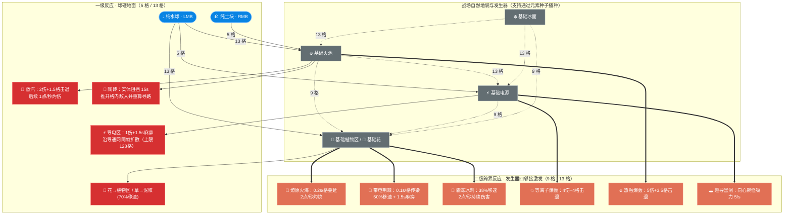
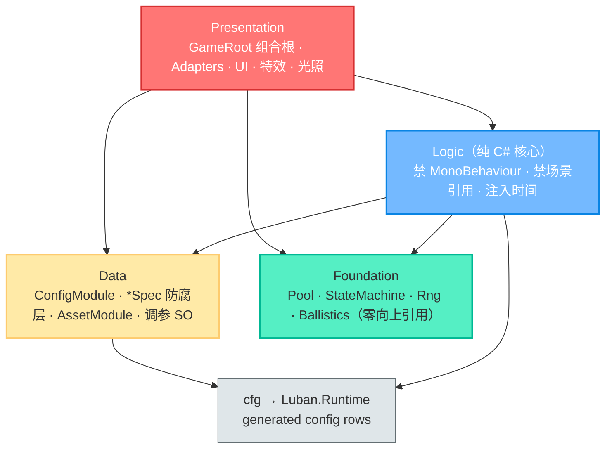
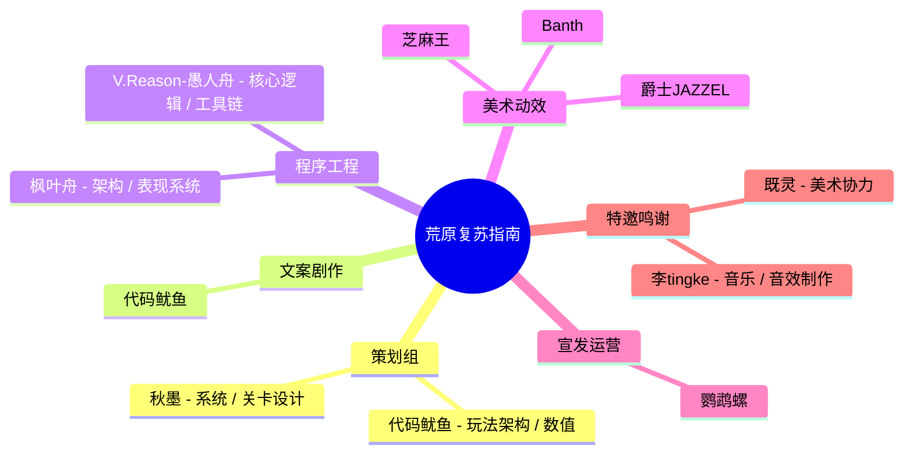

<div align="center">


# 荒原复苏指南 (DeepseaOil)

**当末日降临，法师在吟唱，而你只有两个水龙头和一把铲子。**

[](https://unity.com/)
[](https://unity.com/srp)
[](#四层架构与核心约束)
[](#四层架构与核心约束)
[](#配置管线与调参边界)
[](#-最近大更新摘要v20)

<p>
  <a href="#-一句话定位与核心循环">核心玩法</a> •
  <a href="#-离散反应机制与-5--9--13-格范围">反应与范围</a> •
  <a href="#-实机画面与开发复盘">实机画面</a> •
  <a href="#-操作键位速查">操作键位</a> •
  <a href="#-最近大更新摘要v20">v2.0 更新</a> •
  <a href="#-工程开发与门禁入口">开发入口</a> •
  <a href="#-架构与数据边界">架构与配表</a> •
  <a href="#-文档地图">文档地图</a> •
  <a href="#-制作组名单">制作组</a>
</p>

<br />


</div>

---

## 🎮 一句话定位与核心循环

**《荒原复苏指南》** 是一款俯视角 2D 策略生存追逐战游戏：**玩家没有任何直接攻击技能，只能携带纯水、纯土与有限的战备种子，依靠激发战场上的地貌反应与连锁效应来对抗虫群、创造生路。**


### 生存博弈核心规则

- **固定生命上限**：玩家恒定 **5 点生命**，无数值成长；普通怪接触伤害 **1 点**（HP 4），精英怪接触伤害 **2 点**（HP 9）。
- **受击脱困机制**：受击后获得 **0.8 秒** 无敌保护并关闭与敌人的实体碰撞，伴随受击闪白与 14Hz 闪烁，可直接穿出怪群避免被包围卡死。
- **生命神泉机制**：全图唯一的恢复站（触发半径已扩大 `×1.15`）。进入圈内且保持静止时，充能速率随站定时间加速（`1.0 → 2.8/s`），约 **1.65 秒**即可恢复 1 点生命；圈内短距离走动（`-0.35/s`）或短暂离圈（`-0.60/s`）仅缓慢回落进度，不再瞬间归零。

---

## 📸 实机画面与开发复盘

<table>
  <tr>
    <td width="42%"></td>
    <td width="58%"></td>
  </tr>
  <tr>
    <td></td>
    <td></td>
  </tr>
</table>

截图与动图来自开发复盘记录。完整的设计取舍、白模、光照和粒子迭代过程见：[小黑盒开发复盘帖](https://www.xiaoheihe.cn/app/bbs/link/7acd72af7ca7?h_camp=link&new_post_share_style_v2=1&h_src=YXBwX3NoYXJl)。

---

## 🧪 离散反应机制与 5 / 9 / 13 格范围

项目摒弃了不可见的连续温湿度计算，严格执行 **【所见即所得 · 离散查表 · 首跳当帧】**：

- **落点优先与覆盖秩**：投球落点格无条件触发反应；向外扩散铺地貌时按 `priority`（覆盖秩）判定，护住成型的泥浆（优先级 12）与永久发生器（优先级 20）不被基础水土（优先级 10）轻易顶掉；若激发二级反应，则跳过一级覆写。
- **三档规范作用范围**（基于网格欧氏距离判定，`CellSize = 1`）：
  - **5 格（十字，`r = 1.0`）**：铺水/铺土、生成/稀释泥浆、筑起陶砖、水砸电源生成导电区、冰面结冰等 **16 条**基础一级反应。
  - **9 格（九宫，`r = 1.5`）**：火×植物（燎原火海）、电×植物（带电荆棘）、冰×植物（霜冻冰刺）等 **4 条**植物系二级质变。
  - **13 格（二环十字，`r = 2.0`）**：水砸火池（蒸汽）、水浇基础花（扩成植物区），以及火×电（等离子爆轰）、冰×火（热融爆轰）、冰×电（超导黑洞）等高阶范围反应。



### 元素种子基建（便携发生器）

战备种子通过**波前配给**与**击杀精英怪**获取，单槽持有同一种子时最多可连续播撒 **3 次**：

| 图标 | 种子名称 | 播撒生成地貌 | 典型战术配合 |
| :---: | --- | --- | --- |
|  | **火种子** | 基础火池 | 砸水触发 13 格蒸汽爆轰；砸土快速立陶砖封路；邻接电/冰触发高伤爆轰 |
|  | **电种子** | 基础电源 | 与水/土/泥浆连通后全网同帧电击麻痹；邻接植物铺开带电荆棘 |
|  | **冰种子** | 基础冰面 | 邻接植物铺成 38% 移速重减速霜冻冰刺；邻接电源吸怪聚团 |
|  | **植物种子** | 基础花 | 浇水扩成 13 格基础植物区，作为燎原火海或带电荆棘的连锁燃料 |

> **小技巧**：直接将种子播向已有且能配对的发生器（或非阻挡邻格），即可当场触发或构建二级反应；若包内已有种子，可先按 `Q` 丢在脚边，再拾取波前新配给的种子。

---

## ⌨️ 操作键位速查

| 键位 | 动作 | 功能说明（核对 `InputSys.inputactions`） |
| :---: | :---: | --- |
| <kbd>W</kbd> <kbd>A</kbd> <kbd>S</kbd> <kbd>D</kbd> / 方向键 | **走位移动** | 8 向平滑吸附移动（支持手柄左摇杆 / 十字键） |
| <kbd>Shift</kbd> / <kbd>Space</kbd> | **战术冲刺** | 沿当前朝向高速位移（`1.5s` CD，含 `0.12s` 输入缓冲） |
| <kbd>鼠标左键 (LMB)</kbd> | **投掷水球** | 抛物线投出纯水，触发水系反应或铺设导通水线（上限 5） |
| <kbd>鼠标右键 (RMB)</kbd> | **投掷土块** | 抛物线投出纯土，筑造陶砖路障或混合泥浆（上限 5） |
| <kbd>E</kbd> | **播撒种子** | 向瞄准格插下当前持有的元素种子（非阻挡格可用） |
| <kbd>Q</kbd> | **丢弃种子** | 将当前种子丢至面前地面（带 `1.2s` 防误拾冷却），便于切换新种子 |
| <kbd>Esc</kbd> | **战术暂停** | 暂停 / 恢复游戏与物理时钟，打开暂停菜单 |

> 另：`F` 键绑于 UI 面板切换（`UI/ChangePanel`）；在编辑器或 Development Build 下，关卡内按 `K` 可快速清场验证波次流，按 `L` 可轮转昼/暮/夜环境光照。

---

## 📦 最近大更新摘要（v2.0）

依据 TapTap 26 条玩家评价及测试群/团队实机复核，本轮已完成 `GD-2026-0001 ~ GD-2026-0003` 三批更新及反应扩散优先级修补（当前基线 `main@254b9cf`，处于 **内部可玩版 / 待完整通关验收** 阶段）：

- **玩法与平衡重构**：反应半径规范为 **5 / 9 / 13 格**三档；泥浆优先级提升至 12 防止被水土覆写；生命神泉改为 **约 1.65s 加速回血、短走缓降、触发半径 ×1.15**；受击无敌期可穿怪脱困、死亡原地急停；缩小怪群追速差，霜冻冰刺取消硬定身改为 38% 移速重减速；陶砖生成前推开重叠敌人并实时重建动态寻路；满槽波前种子改落脚边前方避免静默覆盖。
- **引导、UI 与文案升级**：HUD 槽位常驻 `LMB / RMB / E / Q` 提示与水/土/生命泉屏外水珠方向导航；新增波前种子支援与残血轻量浮窗；精简重整 50 句开场与教学文案（统一水井/土丘/水球/土块/生命泉/元素种子称呼）；对话弹窗支持滑入滑出、15 字/秒打字及播完留停 3 秒。
- **视觉与音效反馈**：受击无敌新增 14Hz 闪烁；延长爆轰/电弧光脉冲衰减并稳固暗处光标；补齐打字音与弹窗滑入/滑出短音效。

👉 完整更新对照表、数值变化与待测验收项请查阅：[**`Docs/更新说明/v2.0更新说明.docx`**](Docs/更新说明/v2.0更新说明.docx)

---

## 🚀 工程开发与门禁入口

### 1. 运行环境基线

| 项 | 基线版本 | 说明 |
| --- | --- | --- |
| **Unity Editor** | `2022.3.62f3c1` | LTS，2D 模板 |
| **渲染管线** | URP `14.0.12` | 2D Renderer，Linear 色彩空间 |
| **核心包** | Input System `1.14.2` / TMP `3.0.7` / Cinemachine `2.10.7` | 依赖台账见 [`AI_Context/DEPENDENCIES.md`](AI_Context/DEPENDENCIES.md) |
| **脚本与工具链** | PowerShell 7+ (`pwsh`) · Python `3.10+` | 编译/注释/导表门禁与任务校验脚本 |

### 2. 场景与启动入口

- **完整流程入口**：打开 `Assets/Scenes/Begin.unity`（Build Settings 第 1 项）点击 Play，经主菜单进入教学关 `Assets/Scenes/Levels/Level_0.unity`，后续依次为 `Level_1` ~ `Level_5`。
- **战斗主调试场景**：直接打开 `Assets/Scenes/Range.unity` 并点击 Play，无需经过主菜单即可拉起 HUD 与完整战斗链路；在 `CombatRoot` 上取消勾选 `Enable Level` 可安静测试投掷与网格反应。
- **功能沙盒切片**：`Assets/Scenes/Sandboxes/` 下的 `Slice_GridReaction.unity`（反应调试）、`Slice_CombatSandbox.unity`（受击木桩）、`Slice_PlayerFeel.unity`（移动手感）以及 `Assets/Scenes/Maza.unity`（导航净空调试）。

### 3. 三道工程门禁与测试验证

代码或文档变更提交前，在仓库根目录执行以下已登记门禁（详情见 [`AI_Context/BUILD_AND_TEST.md`](AI_Context/BUILD_AND_TEST.md)）：

```powershell
# 1. 编译与四层拓扑门禁（要求 0 Error / 0 Warning，反向依赖与禁区文件会直接报错）
pwsh Tools/compile-gate.ps1 -Topology

# 2. 注释预算与 XML 标签白名单检查（要求新增/修改代码退出码为 0；注：当前基线存在少量既有超预算历史文件）
pwsh Tools/comment-lint.ps1

# 3. Luban 导表镜像干跑检查（涉及配表或生成物时要求 待删除 / 待覆盖 / 孤儿 .meta 均为 0）
pwsh Tools/luban-mirror.ps1
```

- **EditMode 自动测试**：在 Unity 中打开 `Window ▸ General ▸ Test Runner ▸ EditMode ▸ Run All`（当前未配置统一命令行测试入口，需在编辑器内执行并记录结果）。
- **AI 交接校验**（Python 3.10+）：`python scripts/validate_handover.py AI_Context/TASKS/<TASK_ID> --for <planner|worker|watchdog|archive>`。

---

## 🛠️ 架构与数据边界

### 四层架构与核心约束

工程采用严格的四层程序集物理隔离，**Unity `.asmdef` 引用不传递**，跨层用到基类或公开签名类型所在程序集必须显式声明引用：



- **唯一组合根与双帧收敛**：全工程仅 `GameRoot` 为真单例与常驻 `MonoBehaviour`，统一收口 `Update` / `FixedUpdate` 驱动各 `ISceneRoot`（业务组件禁止私自散落 `Update`）。
- **热路径 0 GC**：`Tick`、`FixedTick`、`OnBallHit`、`TakeDamage` 等高频热路径严禁使用 LINQ、匿名 lambda 闭包、热路径 `GetComponent` 与临时集合/数组分配；物理碰撞优先 `NonAlloc`，容器通过 Scratch 字段与 `Pool<T>` 复用。
- **瓦片网格光照场 (`TileGridLightmap`)**：放弃多点光叠压性能消耗，按地板尺寸烘烤一格一纹素的 Linear `RGBA32` 微型光照纹理，通过 8 邻域两趟正反扫描扩散（空气透过率 `0.75`、阻挡格透光 `0.20`），配合 `EnvironmentDirector` 昼/暮/夜三段过渡驱动全屏 `CelLit` 着色器逐通道取大混合。

### 配置管线与调参边界

- **Excel 真源（14 张登记表）**：核心战斗、元素反应网、地块状态、波次、掉落与对话均在 `ConfigWorkspace/Data/*.xlsx` 中由人工在 Excel 维护（清单以 [`Assets/Scripts/Data/Config/TablesMeta.cs`](Assets/Scripts/Data/Config/TablesMeta.cs) 为准）。严禁运行任何重写 `.xlsx` 源表的脚本。
- **导表生成区（禁止手改）**：Unity 菜单 `Luban ▸ 表格数据导入` 会先导出再镜像覆盖 `Assets/Scripts/Generated/Config/` 与 `Assets/StreamingAssets/Luban/`（`cfg.asmdef` 刻意放置在 `Assets/Scripts/Generated/` 上层以避开镜像清空）。本项目使用本地 `Assets/Luban.Runtime/`，**严禁**安装同名 UPM 包。
- **调参 SO 与 Spec 防腐层**：运动学、抛物线弧度、震屏/闪白、颜色与寻路偏好等体验参数存放于 `Assets/Resources/tuning/*.asset` 与 `config/*.asset`，Play Mode 下修改即时生效；`Logic` 与 `Presentation` 只通过 `*Spec` 包装类取值，不直接绑定生成行结构。

---

## 📚 文档地图

| 分类 | 核心入口文档 | 主要内容 |
| --- | --- | --- |
| **总索引与待办** | [`Docs/README.md`](Docs/README.md) · [`Docs/待办.md`](Docs/待办.md) | 全部文档导航、编辑器人工待验收与后续清理事项 |
| **AI 协作宪法** | [`AGENTS.md`](AGENTS.md) · [`AI_Context/README_AI.md`](AI_Context/README_AI.md) | 任务流角色分工、编译门、注释纪律与生成物禁区 |
| **新手接手** | [`Docs/工程/人类接手与工程交接手册.md`](Docs/工程/人类接手与工程交接手册.md) · [`Docs/工程/加内容清单.md`](Docs/工程/加内容清单.md) | 跑通验证、核心入口速查与新增游戏内容排查清单 |
| **架构与规范** | [`Docs/工程/架构约束.md`](Docs/工程/架构约束.md) · [`Docs/工程/目录说明.md`](Docs/工程/目录说明.md) · [`Docs/工程/注释规范.md`](Docs/工程/注释规范.md) | asmdef 四层铁律、目录命名约定与注释预算规则 |
| **关卡与更新** | [`Docs/工程/关卡编号与场景映射.md`](Docs/工程/关卡编号与场景映射.md) · [`Docs/更新说明/v2.0更新说明.docx`](Docs/更新说明/v2.0更新说明.docx) | `Level_0 ~ Level_5` 主键契约与 v2.0 更新详情 |
| **配表与数据** | [`Docs/配表/策划配表手册.md`](Docs/配表/策划配表手册.md) · [`Docs/配表/技术文档_配表管线.md`](Docs/配表/技术文档_配表管线.md) · [`Docs/配表/最新表格与SO规范.md`](Docs/配表/最新表格与SO规范.md) | 改表规范、导表镜像管线与 Excel / SO 划界原则 |
| **设计与反馈** | [`Docs/设计/策划案_荒原复苏指南_v4.0.md`](Docs/设计/策划案_荒原复苏指南_v4.0.md) · [`Docs/设计/玩家反馈处理指导思想.md`](Docs/设计/玩家反馈处理指导思想.md) | 离散反应设计白皮书与玩家评论过滤转译准则 |
| **表现与美术** | [`Docs/表现/全局光照.md`](Docs/表现/全局光照.md) · [`Docs/表现/新场景接线.md`](Docs/表现/新场景接线.md) · [`Docs/表现/粒子特效系统.md`](Docs/表现/粒子特效系统.md) · [`Docs/美术装配指南.md`](Docs/美术装配指南.md) | 网格光场、图层受光掩码、特效播放与切图装配规范 |

> 注：部分旧版设计文档或交接文档尚未随 `v2.0` 同步回写；若文档叙述与源码、Luban 导出 JSON 或门禁输出冲突，一律以当前代码、配置真源及门禁结果为准。

---

## 🎬 制作组名单

**深海鱼油工作室 (DeepseaOil Studio)**



<div align="center">
  <br />
  <em>“荒原之上，废墟与新生正同时蔓延。那是复苏的曙光，还是更深邃的黑夜？”</em>
</div>
