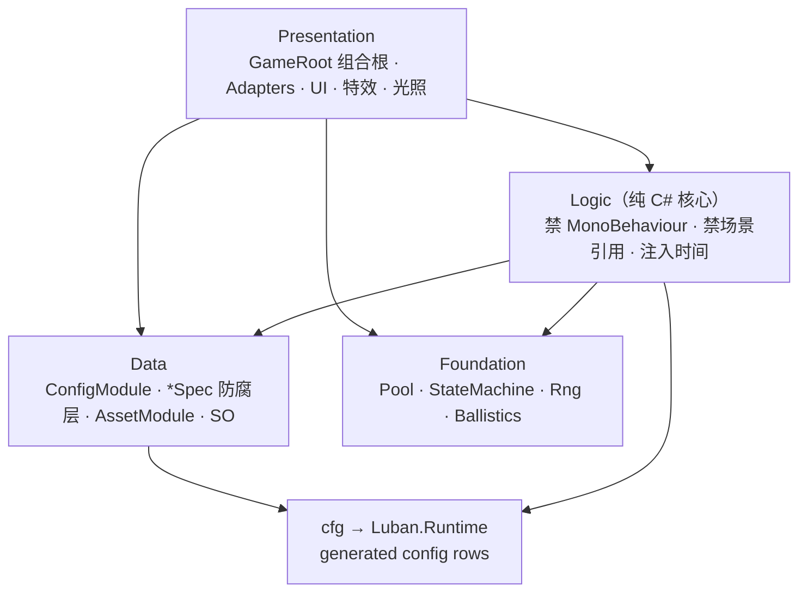

<div align="center">


# 荒原复苏指南

当末日降临，法师在吟唱，而你只有两个水龙头和一把铲子。

[](#工程开发入口)
[](#工程开发入口)
[](#工程开发入口)
[](#v20-最近更新摘要)

<br />


</div>

---

## 核心定位与生存循环

《荒原复苏指南》是一款俯视角 2D 策略生存追逐战。玩家没有任何直接攻击技能，只能携带纯水、纯土与有限的战备种子，依靠激发战场上的地貌反应与网格连锁对抗虫群。


- **固定生命与敌我对抗**：玩家固定 **5 点生命**，无数值成长；普通怪（HP 4）接触造成 1 点伤害，精英怪（HP 9）接触造成 2 点伤害。
- **受击脱困**：受击后拥有 **0.8 秒**无敌时间，期间关闭与敌人层的实体碰撞并伴随闪白与 14Hz 闪烁，可直接穿出怪堆避免卡死。
- **生命神泉规则**：全图唯一的恢复点（触发半径已扩大 `×1.15`）。进圈静止时充能速率由 `1.0` 加速至 `2.8/s`，约 **1.65 秒**恢复 1 点生命；圈内短距离走动（`-0.35/s`）或短暂离圈（`-0.60/s`）仅缓降进度，不再立即清空。

---

## 实机画面与开发复盘

### 静态展示

<p align="center">
  
  <br />
  <sub>宣传图：荒原环境改造工与水土双投掷</sub>
</p>

<p align="center">
  
  <br />
  <sub>关卡总览：多关卡地形预设与网格光照效果</sub>
</p>

### 动态演示

<p align="center">
  
  
  <br />
  <sub>动态演示：蒸汽反应与格网扩散 · 受击形变反馈</sub>
</p>

完整的白模搭建、反应网重构、网格光照与粒子迭代复盘，请阅读小黑盒长文：[《你胆子这是肥嘟嘟的，居然敢用AI开发游戏》](https://www.xiaoheihe.cn/app/bbs/link/7acd72af7ca7?h_camp=link&new_post_share_style_v2=1&h_src=YXBwX3NoYXJl)。

---

## 元素反应与作用范围

项目采用「所见即所得 · 离散查表 · 首跳当帧」机制。投球落点格无条件生效，向外扩散按地貌 `priority` 覆盖秩裁决，保护泥浆（12）与永久发生器（20）不被基础水土（10）轻易顶掉；若激发二级反应，则跳过一级覆写。

### 三档规范作用范围

| 范围档位 | 网格半径 | 典型反应与效果 |
| --- | --- | --- |
| **5 格（十字）** | `r = 1.0` | 基础水/土铺地、泥浆（移速 70%）、稀泥（120%）、陶砖封路（15s，生成时推开格内敌人）、结冰、水砸电源生成导电区（1 伤 + 1.5s 麻痹，并沿导通格同帧扩散，上限 128 格） |
| **9 格（九宫）** | `r = 1.5` | 植物系二级质变：火×植物生成燎原火海（0.2s/格蔓延，2 点/秒灼烧）；电×植物生成带电荆棘（0.1s/格传染，50% 移速 + 1.5s 麻痹）；冰×植物生成霜冻冰刺（38% 移速 + 2 点/秒伤害） |
| **13 格（二环十字）** | `r = 2.0` | 水砸火池（蒸汽：2 伤 + 1.5 格击退）、水浇基础花（扩成植物区），以及火×电等离子爆轰（4 伤 + 4 击退）、冰×火热融爆轰（5 伤 + 3.5 击退）、冰×电超导黑洞（5 单位/秒向心聚怪） |

### 便携元素种子

通过波前配给与击杀精英怪获取，单槽可连续播撒 **3 次**。直接向配对发生器或邻格播种可即时激发二级反应。

| 种子 | 生成地貌 | 核心用途 |
| --- | --- | --- |
| 火种子 | 基础火池 | 砸水触发 13 格蒸汽，砸土筑陶砖，配合电/冰打高额爆轰 |
| 电种子 | 基础电源 | 连通水/土/泥浆触发全网同帧麻痹，或与植物铺开带电荆棘 |
| 冰种子 | 基础冰面 | 配合植物形成重减速霜冻冰刺，或配合电源聚怪控场 |
| 植物种子 | 基础花 | 浇水扩为 13 格基础植物区，作为火海与荆棘的连锁基底 |

---

## 操作键位

| 键位 | 动作 | 说明 |
| --- | --- | --- |
| <kbd>W</kbd> <kbd>A</kbd> <kbd>S</kbd> <kbd>D</kbd> / 方向键 | 移动 | 8 向平滑吸附移动（支持手柄） |
| <kbd>Shift</kbd> / <kbd>Space</kbd> | 冲刺 | 沿朝向高速位移（1.5s 冷却，含 0.12s 输入缓冲） |
| <kbd>LMB</kbd>（鼠标左键） | 投掷水球 | 消耗水弹药，激发水系反应或铺设导通水线 |
| <kbd>RMB</kbd>（鼠标右键） | 投掷土块 | 消耗土弹药，筑造陶砖路障或混合泥浆 |
| <kbd>E</kbd> | 播撒种子 | 向瞄准的非阻挡格插下当前种子 |
| <kbd>Q</kbd> | 丢弃种子 | 将当前种子丢至脚边（1.2s 防误拾冷却），便于切换新种子 |
| <kbd>Esc</kbd> | 暂停 | 暂停或恢复游戏，呼出暂停菜单 |

> 补充：`F` 键用于 UI 面板切换；编辑器与开发包下，关卡内按 `K` 可快速清场验证波次流，按 `L` 可轮转昼/暮/夜光照。

---

## v2.0 最近更新摘要

当前版本为 **v2.0 内部可玩版**（基线 `main@254b9cf`，已完成 `GD-2026-0001 ~ GD-2026-0003` 三批更新及反应扩散优先级修补，完整通关与性能采样尚在收口）。

- **玩法与数值**：规范 5 / 9 / 13 格范围与覆盖秩扩散；生命泉改为约 1.65 秒加速回血与缓降；受击无敌期可穿怪脱困、死亡原地急停；缩小怪群追速差并取消冰刺硬定身；陶砖生成前推开重叠敌人；满槽波前种子改落脚边避免静默覆盖。
- **引导与界面**：HUD 常驻 `LMB / RMB / E / Q` 提示与水/土/生命泉屏外水珠方向导航；新增种子支援与残血浮窗；统一 50 句开场及教学词汇；对话弹窗改为滑入滑出、15 字/秒逐字显示与播完留停 3 秒。
- **视听反馈**：受击无敌新增 14Hz 闪烁；延长爆轰/电弧脉冲光照衰减并稳固暗处光标；补齐打字音与弹窗进出短音效。

详细对照表与待验清单见：[`Docs/更新说明/v2.0更新说明.docx`](Docs/更新说明/v2.0更新说明.docx)。

---

## 工程开发入口

面向接手开发者、协作成员与 AI Agent 的工程约束与验证入口已折叠如下，点击按需展开。

<details>
<summary><strong>1. 运行环境、启动场景与三道工程门禁</strong></summary>

### 环境基线

- **Unity Editor**：`2022.3.62f3c1`（LTS，2D 模板）
- **渲染管线**：URP `14.0.12`（2D Renderer，Linear 色彩空间）
- **工具链**：PowerShell 7+ (`pwsh`)、Python `3.10+`、Input System `1.14.2`、TMP `3.0.7`、Cinemachine `2.10.7`

### 启动场景

- **完整游戏入口**：`Assets/Scenes/Begin.unity`（Build Settings 首场景）→ 教学关 `Assets/Scenes/Levels/Level_0.unity` → `Level_1` ~ `Level_5`。
- **战斗主调试场景**：`Assets/Scenes/Range.unity`（直接 Play 拉起 HUD 与完整玩法链；取消 `CombatRoot.enableLevel` 可单测反应）。
- **切片与导航沙盒**：`Assets/Scenes/Sandboxes/`（`Slice_GridReaction` / `Slice_CombatSandbox` / `Slice_PlayerFeel`）与 `Assets/Scenes/Maza.unity`。

### 工程门禁与测试

在仓库根目录执行（详见 [`AI_Context/BUILD_AND_TEST.md`](AI_Context/BUILD_AND_TEST.md)）：

```powershell
pwsh Tools/compile-gate.ps1 -Topology   # 0 Error / 0 Warning，含四层拓扑反向依赖守卫
pwsh Tools/comment-lint.ps1             # 注释预算与 XML 白名单检查（注：当前基线存在少量超预算历史文件）
pwsh Tools/luban-mirror.ps1             # 导表镜像干跑检查：待删 / 待覆盖 / 孤儿 .meta 应均为 0
```

- **EditMode 测试**：Unity 内运行 `Window ▸ General ▸ Test Runner ▸ EditMode ▸ Run All`（当前无统一 CLI 入口）。
- **交接结构校验**：`python scripts/validate_handover.py AI_Context/TASKS/<TASK_ID> --for <planner|worker|watchdog|archive>`。

</details>

<details>
<summary><strong>2. 四层架构、14 张 Luban 表与热路径 0 GC 约束</strong></summary>

### 四层程序集拓扑

Unity `.asmdef` 引用**不传递**，跨层使用的基类或接口所在程序集必须显式写入 `references`。



- **组合根与驱动收口**：全工程仅 `GameRoot` 为常驻单例，统一调度 `Update` / `FixedUpdate` 推进 `ISceneRoot`，业务组件禁止私自散落 `Update`。
- **热路径 0 GC**：`Tick`、`FixedTick`、`OnBallHit`、`TakeDamage` 等高频热路径严禁 LINQ、匿名闭包、热路径 `GetComponent` 与瞬时容器分配；物理查询优先 `NonAlloc`。
- **瓦片网格光照场**：`TileGridLightmap` 每帧按地板尺寸烘烤一格一纹素的 Linear `RGBA32` 光照图，通过 8 邻域两趟正反扫描扩散（空气透过率 `0.75`、墙体透光 `0.20`），协同 `EnvironmentDirector` 昼/暮/夜过渡驱动全屏 `CelLit` 着色器。

### 配表与调参边界

- **14 张 Excel 真源**：核心规则与数值维护于 `ConfigWorkspace/Data/*.xlsx`（清单以 [`Assets/Scripts/Data/Config/TablesMeta.cs`](Assets/Scripts/Data/Config/TablesMeta.cs) 为准），严禁运行脚本重写源表。
- **生成物禁区**：Unity 菜单 `Luban ▸ 表格数据导入` 镜像生成至 `Assets/Scripts/Generated/Config/` 与 `Assets/StreamingAssets/Luban/`（`cfg.asmdef` 置于 `Generated/` 上层以避免被覆盖）。项目使用本地 `Assets/Luban.Runtime/`，禁止安装同名 UPM 包。
- **SO 调参与防腐层**：运动学、抛物线、震屏与视觉偏好存放于 `Assets/Resources/tuning/*.asset` 与 `config/*.asset`，Play Mode 即时生效；上层仅通过 `*Spec` 包装类读取配置。

</details>

<details>
<summary><strong>3. 文档地图（点击展开）</strong></summary>

| 分类 | 核心文档入口 |
| --- | --- |
| 总索引与待办 | [`Docs/README.md`](Docs/README.md) · [`Docs/待办.md`](Docs/待办.md) |
| AI 协作宪法 | [`AGENTS.md`](AGENTS.md) · [`AI_Context/README_AI.md`](AI_Context/README_AI.md) |
| 新手接手 | [`Docs/工程/人类接手与工程交接手册.md`](Docs/工程/人类接手与工程交接手册.md) · [`Docs/工程/加内容清单.md`](Docs/工程/加内容清单.md) |
| 架构与规范 | [`Docs/工程/架构约束.md`](Docs/工程/架构约束.md) · [`Docs/工程/目录说明.md`](Docs/工程/目录说明.md) · [`Docs/工程/注释规范.md`](Docs/工程/注释规范.md) |
| 关卡与更新 | [`Docs/工程/关卡编号与场景映射.md`](Docs/工程/关卡编号与场景映射.md) · [`Docs/更新说明/v2.0更新说明.docx`](Docs/更新说明/v2.0更新说明.docx) |
| 配表与数据 | [`Docs/配表/策划配表手册.md`](Docs/配表/策划配表手册.md) · [`Docs/配表/技术文档_配表管线.md`](Docs/配表/技术文档_配表管线.md) · [`Docs/配表/最新表格与SO规范.md`](Docs/配表/最新表格与SO规范.md) |
| 设计与反馈 | [`Docs/设计/策划案_荒原复苏指南_v4.0.md`](Docs/设计/策划案_荒原复苏指南_v4.0.md) · [`Docs/设计/玩家反馈处理指导思想.md`](Docs/设计/玩家反馈处理指导思想.md) |
| 表现与美术 | [`Docs/表现/全局光照.md`](Docs/表现/全局光照.md) · [`Docs/表现/新场景接线.md`](Docs/表现/新场景接线.md) · [`Docs/表现/粒子特效系统.md`](Docs/表现/粒子特效系统.md) · [`Docs/美术装配指南.md`](Docs/美术装配指南.md) |

> 注：若个别旧文档尚未随 v2.0 同步回写，一律以当前源码、Luban 导出 JSON 与门禁输出为准。

</details>

---

## 制作组名单

**深海鱼油工作室**

| 分组 | 人员 |
| --- | --- |
| 策划 | 代码鱿鱼、秋墨 |
| 文案 | 代码鱿鱼 |
| 程序 | 枫叶舟、V.Reason-愚人舟 |
| 美术 | Banth、芝麻王、爵士JAZZEL |
| 运营 | 鹦鹉螺 |
| 特别鸣谢 · 音乐 / 音效 | 李tingke |
| 特别鸣谢 · 美术 | 既灵 |

<div align="center">
  <br />
  <em>荒原之上，废墟与新生正同时蔓延。那是复苏的曙光，还是更深邃的黑夜？</em>
</div>
