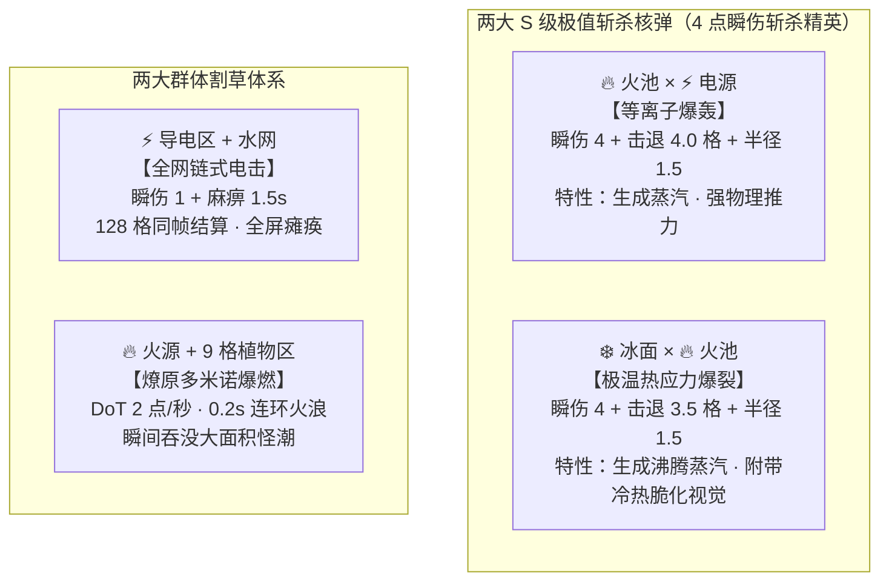
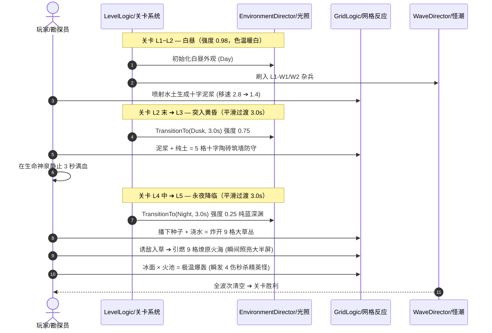

# 《荒原复苏指南》全域关卡与战斗重构规格书 (v5.0)

---

## 一、 系统机制推演与反应重构

### 1.1 斩杀双核重塑（冰火双核对标）
原设计中 `基础冰面 + 基础火池` 绑定的“热应力白雾清仇恨”已随仇恨状态机物理下线而废弃。现将其全面重塑为与【等离子爆轰（火+电）】同级的 S 级斩杀核弹——**【极温热应力爆裂】(Cryo-Thermal Shatter)**。



### 1.2 几何数学与范围地貌契约
为杜绝向配置表盲目堆砌一次性字段，地貌覆盖范围与 `impact_radius`（欧氏距离 $R$）严格咬合：
- **十字范围（5 格）**：取 $R = 1.0$。在正方格网中，满足 $\Delta x^2 + \Delta y^2 \le 1.0^2$ 的格子为 $(0,0)$ 与 $(\pm 1, 0), (0, \pm 1)$，**对角线格距为 $\sqrt{2} \approx 1.414 > 1.0$，被精确剔除**。
- **九宫格范围（9 格）**：取 $R = 1.5$。对角线格距 $1.414 \le 1.5$，**自动纳入对角线 4 格，精准覆盖 $3 \times 3$ 矩形**。

---

## 二、 全量配置表修改清单 (Excel / Luban 真源)

> 以下表格可直接由数据策划 1:1 录入 `ConfigWorkspace/Data/*.xlsx`，并通过 `Luban ▸ 表格数据导入` 编译。

### 1. 敌人数值表 (`enemy.xlsx`)
- **调整理由**：移速削减 15%~20%，拉长怪潮冲刺到脸前的 TTK（击杀窗口）；精英怪血量上调至 8（需挨两发 4 伤斩杀，或一发斩杀加水土平 A，具备 BOSS 战压迫感）。

|  id   | name   |     max_speed     |      hp       | contact_damage | 策划设计说明                     |
| :---: | :----- | :---------------: | :-----------: | :------------: | :------------------------------- |
| **1** | 普通怪 | **2.8** *(原3.5)* |       3       |       1        | 基础炮灰，成群排队踩陷阱         |
| **2** | 精英怪 | **3.4** *(原4.2)* | **8** *(原6)* |       2        | 移动肉盾，带头冲锋，必掉战备种子 |

### 2. 地块状态表 (`tile_state.xlsx`)
- **调整理由**：普通泥浆锁定 10 秒；陶砖阻挡墙定为 12 秒，为生命神泉争取绝对安全的 3 秒回血窗口，并预留 9 秒走位撤离期。

| id             | name       |    duration     | dot_damage | slow_rate | touch_stun | is_obstacle | is_conductor |
| :------------- | :--------- | :-------------: | :--------: | :-------: | :--------: | :---------: | :----------: |
| **空地**       | 空地       |       -1        |     0      |    1.0    |     0      |    FALSE    |    FALSE     |
| **基础水**     | 基础水     |       -1        |     0      |    1.0    |     0      |    FALSE    |   **TRUE**   |
| **基础土**     | 基础土     |       -1        |     0      |    1.0    |     0      |    FALSE    |   **TRUE**   |
| **普通泥浆**   | 普通泥浆   |     **10**      |     0      |  **0.5**  |     0      |    FALSE    |   **TRUE**   |
| **稀泥**       | 稀泥       |        8        |     0      |    1.2    |     0      |    FALSE    |     TRUE     |
| **基础火池**   | 基础火池   |       -1        |     0      |    1.0    |     0      |    FALSE    |    FALSE     |
| **基础电源**   | 基础电源   |       -1        |     0      |    1.0    |     0      |    FALSE    |    FALSE     |
| **基础冰面**   | 基础冰面   |       -1        |     0      |    1.0    |     0      |    FALSE    |    FALSE     |
| **基础植物区** | 基础植物区 |       -1        |     0      |    0.7    |     0      |    FALSE    |    FALSE     |
| **陶砖**       | 陶砖       | **12** *(原15)* |     0      |    1.0    |     0      |  **TRUE**   |    FALSE     |
| **结冰**       | 结冰       |        8        |     0      |    1.0    |     0      |    FALSE    |    FALSE     |
| **蒸汽**       | 蒸汽       |        3        |     1      |    1.0    |     0      |    FALSE    |    FALSE     |
| **导电区**     | 导电区     |        3        |     1      |    1.0    |     0      |    FALSE    |   **TRUE**   |
| **燎原火海**   | 燎原火海   |        3        |     2      |    1.0    |     0      |    FALSE    |    FALSE     |
| **带电荆棘**   | 带电荆棘   |       -1        |     1      |    0.4    |  **1.5**   |    FALSE    |    FALSE     |
| **霜冻冰刺**   | 霜冻冰刺   |       -1        |     1      |    0.5    |     0      |    FALSE    |    FALSE     |
| **基础花**     | 基础花     |       -1        |     0      |    1.0    |     0      |    FALSE    |    FALSE     |

### 3. 一级元素反应规则表 (`element_rule.xlsx`)
- **调整理由**：将泥浆、陶砖设为 $R=1.0$（十字 5 格），将花+水设为 $R=1.5$（九宫 9 格）。

|   id   | source_tile | ball_type | result_tile | impact_damage | impact_knockback | impact_stun | impact_radius | trigger_chain |
| :----: | :---------- | :-------- | :---------- | :-----------: | :--------------: | :---------: | :-----------: | :-----------: |
| **1**  | 基础土      | 纯水      | 普通泥浆    |       1       |        0         |      0      |    **1.0**    |     FALSE     |
| **2**  | 基础水      | 纯土      | 普通泥浆    |       1       |        0         |      0      |    **1.0**    |     FALSE     |
| **3**  | 普通泥浆    | 纯水      | 稀泥        |       0       |        1         |      0      |      1.5      |     FALSE     |
| **4**  | 基础火池    | 纯水      | 蒸汽        |       2       |       1.5        |      0      |      1.5      |     FALSE     |
| **5**  | 基础火池    | 纯土      | 陶砖        |       0       |        1         |      0      |    **1.0**    |     FALSE     |
| **6**  | 基础电源    | 纯水      | 导电区      |       1       |        0         |     1.5     |      1.0      |   **TRUE**    |
| **7**  | 基础冰面    | 纯水      | 结冰        |       0       |        1         |      0      |      1.5      |     FALSE     |
| **8**  | 基础植物区  | 纯水      | 普通泥浆    |       1       |        0         |      0      |      1.0      |     FALSE     |
| **9**  | 普通泥浆    | 纯土      | 陶砖        |       0       |        1         |      0      |    **1.0**    |     FALSE     |
| **10** | 基础电源    | 纯土      | 陶砖        |       0       |        1         |      0      |    **1.0**    |     FALSE     |
| **11** | 基础植物区  | 纯土      | 陶砖        |       0       |        1         |      0      |    **1.0**    |     FALSE     |
| **12** | 基础冰面    | 纯土      | 结冰        |       0       |        1         |      0      |      1.5      |     FALSE     |
| **13** | 空地        | 纯水      | 基础水      |       1       |        0         |      0      |      1.0      |     FALSE     |
| **14** | 空地        | 纯土      | 基础土      |       1       |        0         |      0      |      1.0      |     FALSE     |
| **15** | 基础花      | 纯水      | 基础植物区  |       0       |        0         |      0      |    **1.5**    |     FALSE     |
| **16** | 基础花      | 纯土      | 陶砖        |       0       |        1         |      0      |    **1.0**    |     FALSE     |

### 4. 二级元素跨界反应表 (`element_duo_reaction.xlsx`)
- **调整理由**：彻底更正 id=5，废除 `break_aggro`，重构成与 id=2 平级的 S 级极温核弹。

|  id   | elem_a       | elem_b       | result_tile | impact_damage | impact_knockback | result_duration |   effect_radius   | pull_strength | break_aggro | trigger_chain |
| :---: | :----------- | :----------- | :---------- | :-----------: | :--------------: | :-------------: | :---------------: | :-----------: | :---------: | :-----------: |
| **1** | 基础火池     | 基础植物区   | 燎原火海    |       0       |        0         |        3        |        1.0        |       0       |    FALSE    |   **TRUE**    |
| **2** | 基础火池     | 基础电源     | 蒸汽        |     **4**     |     **4.0**      |        2        |        1.5        |       0       |    FALSE    |     FALSE     |
| **3** | 基础冰面     | 基础电源     | 结冰        |       0       |        0         |        4        |        2.5        |     **5**     |    FALSE    |     FALSE     |
| **4** | 基础电源     | 基础植物区   | 带电荆棘    |       1       |        0         |        3        |        1.0        |       0       |    FALSE    |   **TRUE**    |
| **5** | **基础冰面** | **基础火池** | **蒸汽**    | **4** *(原0)* | **3.5** *(原0)*  |  **3** *(原6)*  | **1.5** *(原2.5)* |       0       |  **FALSE**  |     FALSE     |
| **6** | 基础冰面     | 基础植物区   | 霜冻冰刺    |       1       |        0         |        3        |        1.0        |       0       |    FALSE    |     FALSE     |

### 5. 波次时间与配给表 (`wave.xlsx`)
- **调整理由**：刷怪间隔收窄至 0.15s~0.20s，压迫感倍增；波前配发种子作为局内临时 Build 资源。

|   id   | name  | prep_time | battle_time | settle_time | spawn_interval | grant_seed | 战术目标                       |
| :----: | :---- | :-------: | :---------: | :---------: | :------------: | :--------: | :----------------------------- |
| **1**  | L1-W1 |     3     |     25      |      5      |      0.20      |    None    | 单怪热身，掌握水土平A          |
| **2**  | L1-W2 |     3     |     30      |      5      |      0.18      |    None    | 5怪成队，练习十字泥浆减速      |
| **3**  | L2-W1 |     4     |     30      |      5      |      0.18      |    None    | 遭遇战，练习十字陶砖堵门       |
| **4**  | L2-W2 |     4     |     35      |      5      |      0.16      |    None    | 狭道防守，聚怪蒸汽爆轰         |
| **5**  | L2-W3 |     3     |     40      |      6      |      0.15      |    None    | 二关小潮，诱敌引爆火海         |
| **6**  | L3-W1 |     5     |     30      |      5      |      0.18      |    Fire    | 配发火种，练习种花+浇水炸草    |
| **7**  | L3-W2 |     4     |     40      |      5      |      0.16      |    Fire    | 精英出场，击杀摸种子防守       |
| **8**  | L3-W3 |     4     |     45      |      6      |      0.15      |    Fire    | 燎原大火连环清屏               |
| **9**  | L4-W1 |     5     |     35      |      5      |      0.16      |    Elec    | 电网初战，水线泛洪全屏瘫痪     |
| **10** | L4-W2 |     4     |     45      |      5      |      0.15      |    Elec    | **黄昏入夜**，带电荆棘点亮防线 |
| **11** | L4-W3 |     4     |     50      |      6      |      0.15      |    Elec    | 双精英施压，等离子爆轰秒杀     |
| **12** | L5-W1 |     5     |     40      |      5      |      0.15      |    Fire    | **永夜终局**，全暗视野开局     |
| **13** | L5-W2 |     4     |     45      |      5      |      0.15      |    Elec    | 怪物海啸，冰火斩杀核弹连发     |
| **14** | L5-W3 |     4     |     50      |      5      |      0.15      |    Ice     | 超导黑洞向心聚怪 + 极温爆轰    |
| **15** | L5-W4 |     3     |     60      |      8      |      0.15      |   Plant    | 终极割草狂欢，全元素终极对抗   |

### 6. 波次敌种数量表 (`wave_enemy.xlsx`)
- **调整理由**：总怪量提升超 300%，后期同屏小怪超 30 只，精英怪按阶梯登场。

|   id   | wave_id | enemy_id | count | 战术意图与怪潮规模                   |
| :----: | :-----: | :------: | :---: | :----------------------------------- |
| **1**  |    1    |    1     |   4   | 4 普怪                               |
| **2**  |    2    |    1     |   8   | 8 普怪                               |
| **3**  |    3    |    1     |  10   | 10 普怪                              |
| **4**  |    4    |    1     |  14   | 14 普怪                              |
| **5**  |    5    |    1     |  18   | 18 普怪                              |
| **6**  |    6    |    1     |  12   | 12 普怪                              |
| **7**  |    7    |    1     |  14   | 14 普怪 + 1 精英                     |
| **8**  |    7    |    2     |   1   | ⬆ 首只精英怪登场送种子               |
| **9**  |    8    |    1     |  20   | 20 普怪 + 2 精英                     |
| **10** |    8    |    2     |   2   | ⬆ 双精英高压协同                     |
| **11** |    9    |    1     |  16   | 16 普怪 + 1 精英                     |
| **12** |    9    |    2     |   1   | ⬆                                    |
| **13** |   10    |    1     |  22   | 22 普怪 + 2 精英（入夜前蜂拥）       |
| **14** |   10    |    2     |   2   | ⬆                                    |
| **15** |   11    |    1     |  26   | 26 普怪 + 3 精英（黑夜大战）         |
| **16** |   11    |    2     |   3   | ⬆                                    |
| **17** |   12    |    1     |  20   | 20 普怪 + 2 精英（永夜开幕）         |
| **18** |   12    |    2     |   2   | ⬆                                    |
| **19** |   13    |    1     |  28   | 28 普怪 + 3 精英（大群蜂拥）         |
| **20** |   13    |    2     |   3   | ⬆                                    |
| **21** |   14    |    1     |  32   | 32 普怪 + 4 精英                     |
| **22** |   14    |    2     |   4   | ⬆                                    |
| **23** |   15    |    1     |  40   | **40 普怪 + 5 精英（终极割草狂欢）** |
| **24** |   15    |    2     |   5   | ⬆ 满屏敌潮，一发大招歼灭             |

### 7. 关卡波次映射表 (`level_wave.xlsx`)
- **调整理由**：关卡严格执行 2/3/3/3/4 波次编制。

| id (关卡ID) | wave_ids      | 关卡名称与核心体验                                     |
| :---------: | :------------ | :----------------------------------------------------- |
|    **1**    | `1;2`         | 第一关：荒原破晓（白昼，2波单点反应）                  |
|    **2**    | `3;4;5`       | 第二关：夕照残垣（白昼 $\to$ 黄昏，3波陶砖防线）       |
|    **3**    | `6;7;8`       | 第三关：雷暴前夜（黄昏，3波草丛大火+精英种子）         |
|    **4**    | `9;10;11`     | 第四关：极暗蚀穴（黄昏 $\to$ 夜晚，3波入夜等离子爆轰） |
|    **5**    | `12;13;14;15` | 第五关：永夜终局（深夜，4波全元素狂欢大暴兵）          |

---

## 三、 关卡全局样貌与动态演进规格书

### 3.1 地图宏观拓扑结构 (60 × 30 竞技场)
全关卡统一在 `Range.unity` 规格基准盘上运行，活动区域严格由 `BoundsArea` 约束：

```text
  (-30, 15)                                                        (30, 15)
  ┌────────────────────────────────────────────────────────────────────────┐
  │ [西北防线]                     【北侧 · 高压水井】             [东北防线] │
  │ · 预置基础火池 × 2               (0, 9) 汲取水弹药(5)          · 预置基础电源 × 2│
  │ · 临近枯萎灌木丛区                                             · 连通浅水导电槽 │
  │                                                                        │
  │                         [中央多功能平原]                                │
  │                    · 预设大面积植物区 + 零散水洼                        │
  │                    · 玩家首发开火与九宫草展开主战场                      │
  │                                                                        │
  │ 【西南 · 裂解土丘】             玩家初始坐标 (0, 0)          【东南 · 生命神泉】 │
  │ (-18, -6) 汲取土弹药(5)                                      (18, -6) ICU回血站│
  │ · 预置基础干冰裂缝 × 2                                       · 需九宫格完全静止3s│
  │ · 适合极温爆轰反打                                           · 需陶砖十字筑墙防守│
  └────────────────────────────────────────────────────────────────────────┘
  (-30, -15)                                                       (30, -15)
```

### 3.2 关卡逐幕推进与时段流转全景表



#### 逐关详细规格说明：

#### **第一关：荒原破晓 (Day · 启蒙)**
- **光照状态**：白昼 (`Day`)，全局强度 $0.98$，无色偏暖白。
- **初始地貌布局**：中央散落 12 格基础水与 12 格基础土。无火、无电、无冰。
- **战术核心**：
  - W1（4 怪）：水枪直击与土块试射，感知碰撞伤害。
  - W2（8 怪）：怪物抱团，引导玩家在怪物行进前路投掷【水+土】，触发 **5 格十字泥浆**。怪物移速从 $2.8$ 骤降至 $1.4$，展现风筝压制力。

#### **第二关：夕照残垣 (Day $\to$ Dusk · 防线)**
- **光照状态**：开局白昼；进入 W2 时平滑插值 $3.0\text{s}$ 步入**黄昏 (`Dusk`)**，主光降至 $0.75$，天色转为浓烈橙金。
- **初始地貌布局**：西北角出现 2 处【基础火池】；东南神泉前方有一条 $2$ 格宽的狭窄石巷。
- **战术核心**：
  - W1~W2：引怪至火池旁，水球砸火池触发【蒸汽爆轰】（瞬伤 2 点+推开 1.5 格，配合暖白强光脉冲）。
  - W3（18 怪压境）：怪量暴增，逼迫玩家在狭窄石巷丢出【泥浆+纯土】，拔地而起 **5 格十字陶砖墙**，将怪潮全数堵死在巷外。玩家从容退入神泉，**在墙体自然瓦解前的 12 秒内，稳稳站满 3 秒无伤回血**。

#### **第三关：雷暴前夜 (Dusk · 燃料库)**
- **光照状态**：黄昏全覆盖，环境光强 $0.75$。
- **初始地貌布局**：中央散布大片【基础植物区】；首发配发【火种子】；精英怪（8 血）首次在 W2 登场。
- **战术核心**：
  - W1：玩家播下火种子生成火池，熟悉火与草的交互。
  - W2：击杀首只精英怪，必掉战备种子（植物或火）。
  - W3（20 普 + 2 精）：怪潮合围。玩家按 <kbd>E</kbd> 种下【基础花】，一发水枪浇上——**九宫格 9 格草丛瞬间爆裂展开**！大群变异虫涌入草丛被减速 $30\%$；玩家引火点燃，**9 格火海以 $0.2\text{s}$ 一圈的节奏连环引爆**，满屏红光闪烁，20+ 怪物同屏化灰。

#### **第四关：极暗蚀穴 (Dusk $\to$ Night · 入夜与斩杀)**
- **光照状态**：W1 为黄昏尾声；进入 W2 开战时刻，触发 `TransitionTo(Night, 3.0s)`，**深渊纯蓝黑夜降临（强度 $0.25$）**！全屏能见度被极限压制，唯有神泉、火光与随身手电可见。
- **初始地貌布局**：东北角接入【基础电源】与导电水带；西南角铺设【基础冰面】。
- **战术核心**：
  - W2（入夜）：黑夜中怪物红眼成群逼近，玩家引怪踩入水带，水球打向电源，**128 格全网连锁闪电同屏炸响，淡紫电弧将黑暗撕裂**，群怪集体麻痹罚站 $1.5\text{s}$。
  - W3（3 精英带队）：双核斩杀展示。玩家将火球投向西南角的【基础冰面】，瞬间触发重构后的 **【极温热应力爆轰】**！4 点巨额瞬伤伴随 3.5 格强击退，当场秒杀残血精英怪。

#### **第五关：永夜终局 (Night · 全域沙盒)**
- **光照状态**：深夜 (`Night`)，全场照度 $0.25$。
- **初始地貌布局**：四角全部铺设高危发生器（火池、电源、冰面、植物丛）。
- **战术核心**：
  - **自建防御灯塔**：玩家开局在神泉周边播种电种与植物，生成【带电荆棘】。带电荆棘享受冷蓝常驻微光，不仅照亮神泉周边视野，更构筑起 $1.5\text{s}$ 定身防空护城河。
  - W3~W4（40 普怪 + 5 精英海啸冲击）：全元素大乱斗。超导黑洞强力聚怪 $\to$ 极温爆轰与等离子爆轰交替斩杀 $\to$ 9 格草丛燎原烈火席卷全图，达成大魄力通关结算。

---

## 四、 程序工程详细落地说明书 (Task Book)

--- START OF TASK ---

# 任务书：关卡地质反应、寻路嗜能偏置与光照扩充接入规格书

### 1. 设计意图与交付价值
落地关卡 5.0 核心机制：实现代数半径驱动的 5 格十字泥浆/陶砖与 9 格草丛铺设；实现 0 GC 的敌人邻域“嗜能偏置”主动踩格算法；接入带电荆棘冷光路灯；重构二级反应 id=5 为斩杀核弹；装配 3.0s 平滑时段过渡。

### 2. 铁律与设计红线
- 严禁修改全局 BFS 流场核心数据结构（`NavField` 必须保持无权重无 GC 快速构建）。
- 严禁在热路径中使用 LINQ、匿名 Lambda 闭包或产生任何托管堆分配（0 GC）。
- 严禁让 5 格十字陶砖造成怪物流场彻底死锁（必须附带超时破拆与啃墙兜底）。

### 3. 第一步逻辑输入核对
- 依赖程序集：`DeepseaOil.Logic`、`DeepseaOil.Presentation`、`DeepseaOil.Data`。
- 对应数据源：`element_rule.xlsx`、`element_duo_reaction.xlsx`、`tile_state.xlsx`。

### 4. 核心逻辑实现规格

#### 4.1 几何范围地貌铺设契约 (`GridLogic.cs`)
在 `OnBallHit` 或 `ApplyImpact` 处理 `outcome.NextTile` 转换时，接入基于 `outcome.ImpactRadius` 的几何扩散规则：
```csharp
// 规则：
// 1. impact_radius == 1.0f: 十字 5 格 (中心 + 4 邻域)
// 2. impact_radius == 1.5f: 九宫格 9 格 (中心 + 8 邻域)
// 3. impact_radius <= 0 或单格规则: 仅中心 1 格
if (outcome.ImpactRadius == 1.0f)
{
    SwitchTileState(cell, outcome.NextTile, 0f);
    GridQuery.GetNeighbors4(cell, _crossCells);
    for (int i = 0; i < _crossCells.Count; i++)
    {
        Vector3Int n = _crossCells[i];
        if (HasCell(n) && CanOverwriteTile(n, outcome.NextTile))
            SwitchTileState(n, outcome.NextTile, 0f);
    }
}
else if (outcome.ImpactRadius == 1.5f)
{
    SwitchTileState(cell, outcome.NextTile, 0f);
    GridQuery.GetNeighbors8(cell, _spreadCells);
    for (int i = 0; i < _spreadCells.Count; i++)
    {
        Vector3Int n = _spreadCells[i];
        if (HasCell(n) && CanOverwriteTile(n, outcome.NextTile))
            SwitchTileState(n, outcome.NextTile, 0f);
    }
}

// 保护判定：永久地貌（非 Normal）且非同源地貌不被次级波及覆盖（Normal 地貌允许被改）
private bool CanOverwriteTile(Vector3Int cell, TileStateType next)
{
    TileStateType current = StateOf(cell);
    if (current == next) return false;
    if (current == TileStateType.Normal) return true;
    if (_specs.TryGetValue(current, out TileStateSpec spec) && spec.Duration <= 0f) return false;
    return true;
}
```

#### 4.2 敌人“嗜能引力 (Energy Tropism)”主动踩格算法 (`EnemyNavigator.cs`)
在计算敌人朝向玩家的移动方向时，保持原有流场 $\vec{V}_{\text{flow}}$ 为主干，对敌人周围 4 邻域进行非自杀性良性元素格探测：
```csharp
// 处于物理帧中执行，0 GC
public Vector2 ComputeSteeringDirection(Vector2 currentPos, Vector2 flowDir, GridLogic grid)
{
    Vector3Int currentCell = grid.WorldToCell(currentPos);
    Vector2 attraction = Vector2.zero;
    int attractiveCount = 0;

    // 探查 4 邻域
    GridQuery.GetNeighbors4(currentCell, _neighborScratch);
    for (int i = 0; i < _neighborScratch.Count; i++)
    {
        Vector3Int nCell = _neighborScratch[i];
        TileStateType state = grid.StateOf(nCell);

        // 仅对普通泥浆、水体、植物区、花产生嗜能冲动；严禁被火池与导电区吸引（防自焚搞笑）
        if (state == TileStateType.Mud || state == TileStateType.BasicWater || 
            state == TileStateType.BasicPlant || state == TileStateType.BasicFlower)
        {
            Vector2 tileCenter = grid.Geometry.CellCenter(nCell);
            attraction += (tileCenter - currentPos).normalized;
            attractiveCount++;
        }
    }

    if (attractiveCount > 0)
    {
        // 赋予 30% 偏置引力，70% 保持主追击流向
        return (flowDir * 0.7f + (attraction / attractiveCount) * 0.3f).normalized;
    }

    return flowDir;
}
```

#### 4.3 十字陶砖防死锁与啃墙自愈机制 (`EnemyActor.cs` & `TileObstacleDirector.cs`)
- **生命周期**：`tile_state.xlsx` 中陶砖 `duration = 12.0f`，到期调用 `SwitchTileState(cell, Normal)` 自然消亡。
- **破拆自愈**：在 `EnemyActor.FixedTick` 中，如果怪物的速度持续在 $0.05\,\text{u/s}$ 以下超过 $1.0\text{s}$（`_stuckTimer > 1.0f`），且正前方 $0.5$ 格内检测到陶砖碰撞体：
  - 触发“撕咬啃墙”音效，每物理帧对陶砖地块扣除寿命 $\Delta t \times 4.0$。
  - 最多 $2.0$ 秒内硬性打穿陶砖，恢复全场寻路流场。

#### 4.4 带电荆棘冷光路灯接入 (`TileLightDirector.cs`)
在静态判定方法中补齐 `ChargedThorn`：
```csharp
public static bool TryGetContinuousLight(TileStateType state, out LightKind kind, out Color color, out float intensity, out float range)
{
    // ... 既有火/电判定 ...
    case TileStateType.ChargedThorn:
        kind = LightKind.Electric;
        color = new Color(0.588f, 0.627f, 1f, 1f); // 冷蓝紫
        intensity = 0.85f;
        range = 2.0f;
        return true;
}
```

#### 4.5 昼夜时段无缝切换调度 (`CombatRoot.cs`)
在 `CombatRoot.OnWavePhaseChanged` 中监听波次进入：
```csharp
private void OnWavePhaseChanged(WavePhaseChanged evt)
{
    if (evt.Phase != WavePhase.Battle) return;

    // L2 关卡第 2 波切入黄昏
    if (CurrentLevelId == 2 && evt.WaveIndex == 2)
    {
        _root?.EnvironmentDirector?.TransitionTo(TimeOfDayKind.Dusk);
    }
    // L4 关卡第 2 波切入暗夜
    else if (CurrentLevelId == 4 && evt.WaveIndex == 2)
    {
        _root?.EnvironmentDirector?.TransitionTo(TimeOfDayKind.Night);
    }
}
```

### 5. 跨岗位交付与资产清单
- **[程序接入]**：按上述 4.1~4.5 接入代码，确保通过 `pwsh Tools/compile-gate.ps1`。
- **[关卡策划]**：在 `ConfigWorkspace/Data/` 中更新 7 张表格并执行 `Luban ▸ 表格数据导入`。
- **[美术与表现]**：确认 `ChargedThorn` 贴图带有冷光粒子辉光；核验夜景纯蓝暗度下（$0.25$）带电荆棘与火海的对比辨识度。

--- END OF TASK ---