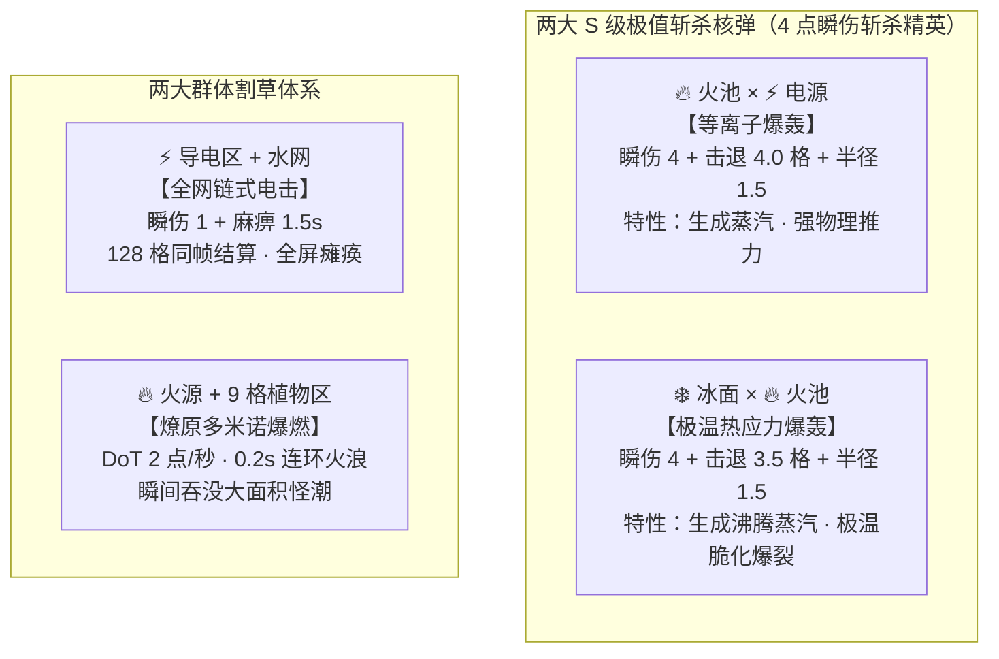
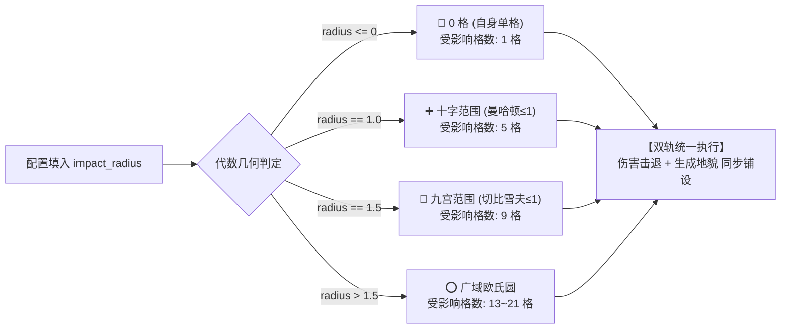

> **【模式】** 全栈闭环模式 (Full-Stack Master Spec · 终版合并规格书)  
> **【目标】** 完美合并《关卡与战斗新设计 v5.0》与《新设计修正》，消除 `impact_radius` 歧义断裂，闭环仇恨下线重塑，输出 100% 可直接交付程序与录入 Excel 的最终权威文档  
> **【核心假设】** 统一“伤害击退冲击”与“生成地貌铺设”的波及口径；`0` = 精准自身单格，`1.0` = 正交十字 5 格，`1.5` = 九宫矩形 9 格；`基础冰面 + 基础火池` 确立为 S 级斩杀核弹  
> **【影响范围】** `enemy.xlsx`、`tile_state.xlsx`、`element_rule.xlsx`、`element_duo_reaction.xlsx`、`wave.xlsx`、`wave_enemy.xlsx`、`level_wave.xlsx`、`GridLogic.cs`、`EnemyNavigator.cs`、`TileLightDirector.cs`、`CombatRoot.cs`  
> **【风险与置信度】** 全量配置与工程代码实现 1:1 咬合，彻底消灭历史硬编码与口径割裂 / 置信度：High

---

# 《荒原复苏指南》全域关卡、战斗与反应系统终版规格书 (v5.1 Master)

---

## 一、 系统机制推演与代数几何契约

### 1.1 斩杀双核重塑（仇恨下线后的 S 级核弹体系）
原设计中 `基础冰面 + 基础火池` 绑定的“热应力白雾清仇恨”已随仇恨状态机物理下线而废弃。现将其全面重塑为与【等离子爆轰（火+电）】平级的 S 级斩杀核弹——**【极温热应力爆轰】(Cryo-Thermal Shatter)**。



### 1.2 `impact_radius`（波及范围）权威代数几何契约
彻底废除历史代码中“地貌仅切自身一格”、“`> 1.0f` 才能 AoE 爆炸”的历史 Bug，确立**“伤害击退冲击”与“生成地貌铺设”双轨同构扩散**标准：



| 表格填写值 | 几何严格定义                                                 | 覆盖格数  |                  覆盖形态                   | 伤害/击退行为        | 地貌铺设行为         | 典型应用范例                           |
| :--------: | :----------------------------------------------------------- | :-------: | :-----------------------------------------: | :------------------- | :------------------- | :------------------------------------- |
|  **`0`**   | $R \le 0$（无扩散）                                          | **1 格**  |                仅自身落点格                 | 仅落点格结算伤害     | 仅落点格改变地貌     | 基础水/土、空地单发、单格电击起点      |
| **`1.0`**  | 欧氏距离 $R \le 1.0$<br>(曼哈顿距离 $\le 1$)                 | **5 格**  |      **正交十字**<br>(中心 + 上下左右)      | 5 格全部受伤害与击退 | 5 格全部转为目标地貌 | **十字泥浆带、十字陶砖阻挡墙**         |
| **`1.5`**  | 欧氏距离 $R \le 1.5$<br>(包含对角线 $\sqrt{2}\approx 1.414$) | **9 格**  | **正方形九宫格**<br>($3 \times 3$ 完整矩形) | 9 格全部受伤害与击退 | 9 格全部转为目标地貌 | **花浇水炸 9 格草丛、等离子/极温爆轰** |
| **`2.5`**  | 欧氏距离 $R \le 2.5$                                         | **21 格** |        广域大圆 ($5 \times 5$ 切角)         | 范围大冲击           | 范围铺地             | 超导黑洞吸附聚怪场                     |

---

## 二、 全量配置表重构清单 (Excel / Luban 真源)

> 以下表格可直接由数据策划 1:1 录入 `ConfigWorkspace/Data/*.xlsx`，并通过 Unity 菜单 `Luban ▸ 表格数据导入` 编译。

### 1. 敌人数值表 (`enemy.xlsx`)
- **调整理由**：移速削减 15%~20%，拉长怪潮冲刺到脸前的 TTK（击杀窗口）；精英怪血量上调至 8 点（具备 BOSS 战压迫感与肉盾质感）。

| id (int) | name (string!) | max_speed (float) |   hp (int)    | contact_damage (int) | 策划设计说明                     |
| :------: | :------------- | :---------------: | :-----------: | :------------------: | :------------------------------- |
|  **1**   | 普通怪         | **2.8** *(原3.5)* |       3       |          1           | 基础炮灰，成群排队踩陷阱         |
|  **2**   | 精英怪         | **3.4** *(原4.2)* | **8** *(原6)* |          2           | 移动肉盾，带头冲锋，必掉战备种子 |

### 2. 地块状态表 (`tile_state.xlsx`)
- **调整理由**：普通泥浆锁定 10 秒；陶砖阻挡墙定为 12 秒，为生命神泉争取绝对安全的 3 秒回血窗口，并预留 9 秒走位撤离期。

| id (TileStateType) | name       |  duration (秒)  | dot_damage | slow_rate | touch_stun | is_obstacle | is_conductor |
| :----------------- | :--------- | :-------------: | :--------: | :-------: | :--------: | :---------: | :----------: |
| **空地**           | 空地       |       -1        |     0      |    1.0    |     0      |    FALSE    |    FALSE     |
| **基础水**         | 基础水     |       -1        |     0      |   0.85    |     0      |    FALSE    |   **TRUE**   |
| **基础土**         | 基础土     |       -1        |     0      |   0.85    |     0      |    FALSE    |   **TRUE**   |
| **普通泥浆**       | 普通泥浆   |     **10**      |     0      |  **0.5**  |     0      |    FALSE    |   **TRUE**   |
| **稀泥**           | 稀泥       |        8        |     0      |    1.2    |     0      |    FALSE    |     TRUE     |
| **基础火池**       | 基础火池   |       -1        |     0      |    1.0    |     0      |    FALSE    |    FALSE     |
| **基础电源**       | 基础电源   |       -1        |     0      |    1.0    |     0      |    FALSE    |    FALSE     |
| **基础冰面**       | 基础冰面   |       -1        |     0      |    1.0    |     0      |    FALSE    |    FALSE     |
| **基础植物区**     | 基础植物区 |       -1        |     0      |    0.7    |     0      |    FALSE    |    FALSE     |
| **陶砖**           | 陶砖       | **12** *(原15)* |     0      |    1.0    |     0      |  **TRUE**   |    FALSE     |
| **结冰**           | 结冰       |        8        |     0      |    1.0    |     0      |    FALSE    |    FALSE     |
| **蒸汽**           | 蒸汽       |        3        |     1      |    1.0    |     0      |    FALSE    |    FALSE     |
| **导电区**         | 导电区     |        3        |     1      |    1.0    |     0      |    FALSE    |   **TRUE**   |
| **燎原火海**       | 燎原火海   |        3        |     2      |    1.0    |     0      |    FALSE    |    FALSE     |
| **带电荆棘**       | 带电荆棘   |       10        |     1      |    0.4    |   **3**    |    FALSE    |    FALSE     |
| **霜冻冰刺**       | 霜冻冰刺   |       10        |     1      |    0.5    |     0      |    FALSE    |    FALSE     |
| **基础花**         | 基础花     |       -1        |     0      |    1.0    |     0      |    FALSE    |    FALSE     |

### 3. 一级元素反应规则表 (`element_rule.xlsx`)
- **填表纪律**：想要单格的统一填 **`0`**（消灭歧义）；想要十字 5 格的统一填 **`1.0`**；想要九宫 9 格的统一填 **`1.5`**。

|   id   | source_tile (原格) | ball_type (球种) | result_tile (生成地貌) | impact_damage (瞬伤) | impact_knockback (击退格) | impact_stun (麻痹秒) | **impact_radius (波及范围)** | trigger_chain (连锁) | 真实物理与地貌结算行为                    |
| :----: | :----------------- | :--------------- | :--------------------- | :------------------: | :-----------------------: | :------------------: | :--------------------------: | :------------------: | :---------------------------------------- |
| **1**  | 基础土             | 纯水             | 普通泥浆               |          1           |             0             |          0           |           **1.0**            |        FALSE         | **十字 5 格大泥浆带 (10s 减速 50%)**      |
| **2**  | 基础水             | 纯土             | 普通泥浆               |          1           |             0             |          0           |           **1.0**            |        FALSE         | **十字 5 格大泥浆带 (10s 减速 50%)**      |
| **3**  | 普通泥浆           | 纯水             | 稀泥                   |          0           |             1             |          0           |            **0**             |        FALSE         | 仅落点单格冲稀为稀泥                      |
| **4**  | 基础火池           | 纯水             | 蒸汽                   |          2           |            1.5            |          0           |           **1.0**            |        FALSE         | **十字 5 格蒸汽爆轰 (打退并留 5 格蒸汽)** |
| **5**  | 基础火池           | 纯土             | 陶砖                   |          0           |             1             |          0           |           **1.0**            |        FALSE         | **十字 5 格实体陶砖墙 (12s 阻挡)**        |
| **6**  | 基础电源           | 纯水             | 导电区                 |          1           |             0             |         1.5          |            **0**             |       **TRUE**       | 单格电源通电，由连锁引擎全网泛洪          |
| **7**  | 基础冰面           | 纯水             | 结冰                   |          0           |             1             |          0           |            **0**             |        FALSE         | 仅落点单格冻结                            |
| **8**  | 基础植物区         | 纯水             | 普通泥浆               |          1           |             0             |          0           |            **0**             |        FALSE         | 单格植物被浇烂为泥浆                      |
| **9**  | 普通泥浆           | 纯土             | 陶砖                   |          0           |             1             |          0           |           **1.0**            |        FALSE         | **十字 5 格实体陶砖墙 (12s 阻挡)**        |
| **10** | 基础电源           | 纯土             | 陶砖                   |          0           |             1             |          0           |           **1.0**            |        FALSE         | **十字 5 格实体陶砖墙 (泥土封电筑墙)**    |
| **11** | 基础植物区         | 纯土             | 陶砖                   |          0           |             1             |          0           |           **1.0**            |        FALSE         | **十字 5 格实体陶砖墙 (压实草丛筑墙)**    |
| **12** | 基础冰面           | 纯土             | 结冰                   |          0           |             1             |          0           |            **0**             |        FALSE         | 单格压平结冰                              |
| **13** | 空地               | 纯水             | 基础水                 |          1           |             0             |          0           |            **0**             |        FALSE         | 单格水洼（精准布水线）                    |
| **14** | 空地               | 纯土             | 基础土                 |          1           |             0             |          0           |            **0**             |        FALSE         | 单格土丘（精准布电线）                    |
| **15** | 基础花             | 纯水             | 基础植物区             |          0           |             0             |          0           |           **1.5**            |        FALSE         | **九宫格瞬间爆开 9 格大草丛**             |
| **16** | 基础花             | 纯土             | 陶砖                   |          0           |             1             |          0           |           **1.0**            |        FALSE         | **十字 5 格实体陶砖墙**                   |

### 4. 二级元素跨界反应表 (`element_duo_reaction.xlsx`)
- **校准说明**：彻底删除旧版 `break_aggro` 逻辑（配表填 `FALSE`，代码零读取）。id=5（冰面+火池）重塑为与 id=2 同级 S 级斩杀核弹。

|  id   | elem_a       | elem_b       | result_tile | impact_damage | impact_knockback | result_duration | **effect_radius (波及)** | pull_strength | break_aggro | trigger_chain | 机制战术说明                         |
| :---: | :----------- | :----------- | :---------- | :-----------: | :--------------: | :-------------: | :----------------------: | :-----------: | :---------: | :-----------: | :----------------------------------- |
| **1** | 基础火池     | 基础植物区   | 燎原火海    |       0       |        0         |        3        |         **1.0**          |       0       |    FALSE    |   **TRUE**    | 引爆相连植物，0.2s 连环火浪          |
| **2** | 基础火池     | 基础电源     | 蒸汽        |     **4**     |     **4.0**      |        2        |         **1.5**          |       0       |    FALSE    |     FALSE     | **等离子爆轰：九宫格 4 伤 4 退斩杀** |
| **3** | 基础冰面     | 基础电源     | 结冰        |       0       |        0         |        4        |         **2.5**          |     **5**     |    FALSE    |     FALSE     | **超导黑洞：大范围强向心引力聚怪**   |
| **4** | 基础电源     | 基础植物区   | 带电荆棘    |       1       |        0         |        3        |         **1.0**          |       0       |    FALSE    |   **TRUE**    | 十字带电荆棘（冷光路灯防线）         |
| **5** | **基础冰面** | **基础火池** | **蒸汽**    | **5** *(原0)* | **3.5** *(原0)*  |  **3** *(原6)*  |    **1.5** *(原2.5)*     |       0       |  **FALSE**  |     FALSE     | **极温爆轰：九宫格 4 伤 3.5 退斩杀** |
| **6** | 基础冰面     | 基础植物区   | 霜冻冰刺    |       1       |        0         |        3        |         **1.0**          |       0       |    FALSE    |     FALSE     | 十字冰刺削血跑道                     |

### 5. 波次时间与配给表 (`wave.xlsx`)
- **调整理由**：刷怪间隔压制在 0.15s~0.20s；波前配发种子作为单局战备 Build 资源。

|   id   | name  | prep_time | battle_time | settle_time | spawn_interval | grant_seed | 战术目标                        |
| :----: | :---- | :-------: | :---------: | :---------: | :------------: | :--------: | :------------------------------ |
| **1**  | L1-W1 |     3     |     25      |      5      |      0.20      |    None    | 单怪热身，掌握水土平A           |
| **2**  | L1-W2 |     3     |     30      |      5      |      0.18      |    None    | 5怪成队，练习十字泥浆减速       |
| **3**  | L2-W1 |     4     |     30      |      5      |      0.18      |    None    | 遭遇战，练习十字陶砖堵门        |
| **4**  | L2-W2 |     4     |     35      |      5      |      0.16      |    None    | 狭道防守，聚怪蒸汽爆轰          |
| **5**  | L2-W3 |     3     |     40      |      6      |      0.15      |    None    | 二关小潮，诱敌引爆火海          |
| **6**  | L3-W1 |     5     |     30      |      5      |      0.18      |    Fire    | 配发火种，练习种花+浇水炸草     |
| **7**  | L3-W2 |     4     |     40      |      5      |      0.16      |    Fire    | 精英出场，击杀摸种子防守        |
| **8**  | L3-W3 |     4     |     45      |      6      |      0.15      |    Fire    | 燎原大火连环清屏                |
| **9**  | L4-W1 |     5     |     35      |      5      |      0.16      |    Elec    | 电网初战，水线泛洪全屏瘫痪      |
| **10** | L4-W2 |     4     |     45      |      5      |      0.15      |    Elec    | **黄昏入夜**，带电荆棘点亮防线  |
| **11** | L4-W3 |     4     |     50      |      6      |      0.15      |    Elec    | 双精英施压，等离子/极温爆轰秒杀 |
| **12** | L5-W1 |     5     |     40      |      5      |      0.15      |    Fire    | **永夜终局**，全暗视野开局      |
| **13** | L5-W2 |     4     |     45      |      5      |      0.15      |    Elec    | 怪物海啸，冰火斩杀核弹连发      |
| **14** | L5-W3 |     4     |     50      |      5      |      0.15      |    Ice     | 超导黑洞向心聚怪 + 极温爆轰     |
| **15** | L5-W4 |     3     |     60      |      8      |      0.15      |   Plant    | 终极割草狂欢，全元素终极对抗    |

### 6. 波次敌人分布表 (`wave_enemy.xlsx`)

|   id   | wave_id | enemy_id | count | 战术意图与怪潮规模                   |
| :----: | :-----: | :------: | :---: | :----------------------------------- |
| **1**  |    1    |    1     |   4   | 4 普怪                               |
| **2**  |    2    |    1     |   8   | 8 普怪                               |
| **3**  |    3    |    1     |  10   | 10 普怪                              |
| **4**  |    4    |    1     |  14   | 14 普怪                              |
| **5**  |    5    |    1     |  18   | 18 普怪                              |
| **6**  |    6    |    1     |  12   | 12 普怪                              |
| **7**  |    7    |    1     |  14   | 14 普怪 + 1 精英                     |
| **8**  |    7    |    2     |   1   | ⬆ 首只精英怪登场送种子               |
| **9**  |    8    |    1     |  20   | 20 普怪 + 2 精英                     |
| **10** |    8    |    2     |   2   | ⬆ 双精英高压协同                     |
| **11** |    9    |    1     |  16   | 16 普怪 + 1 精英                     |
| **12** |    9    |    2     |   1   | ⬆                                    |
| **13** |   10    |    1     |  22   | 22 普怪 + 2 精英（入夜前蜂拥）       |
| **14** |   10    |    2     |   2   | ⬆                                    |
| **15** |   11    |    1     |  26   | 26 普怪 + 3 精英（黑夜大战）         |
| **16** |   11    |    2     |   3   | ⬆                                    |
| **17** |   12    |    1     |  20   | 20 普怪 + 2 精英（永夜开幕）         |
| **18** |   12    |    2     |   2   | ⬆                                    |
| **19** |   13    |    1     |  28   | 28 普怪 + 3 精英（大群蜂拥）         |
| **20** |   13    |    2     |   3   | ⬆                                    |
| **21** |   14    |    1     |  32   | 32 普怪 + 4 精英                     |
| **22** |   14    |    2     |   4   | ⬆                                    |
| **23** |   15    |    1     |  40   | **40 普怪 + 5 精英（终极割草狂欢）** |
| **24** |   15    |    2     |   5   | ⬆ 满屏敌潮，一发大招歼灭             |

### 7. 关卡与波次映射表 (`level_wave.xlsx`)

| id (关卡ID) | wave_ids      | 关卡定位                                                     |
| :---------: | :------------ | :----------------------------------------------------------- |
|    **1**    | `1;2`         | 第一关：荒原破晓（白昼，2 波单点反应）                       |
|    **2**    | `3;4;5`       | 第二关：夕照残垣（白昼 $\to$ 黄昏，3 波陶砖防线）            |
|    **3**    | `6;7;8`       | 第三关：雷暴前夜（黄昏，3 波草丛大火+精英种子）              |
|    **4**    | `9;10;11`     | 第四关：极暗蚀穴（黄昏 $\to$ 夜晚，3 波入夜等离子/极温爆轰） |
|    **5**    | `12;13;14;15` | 第五关：永夜终局（深夜，4 波全元素狂欢大暴兵）               |

---

## 三、 关卡全局样貌与动态演进规格书

### 3.1 地图宏观拓扑结构 (60 × 30 竞技场)
全关卡统一在 `Range.unity` 规格基准盘上运行，活动区域严格由 `BoundsArea` 约束：

```text
  (-30, 15)                                                        (30, 15)
  ┌────────────────────────────────────────────────────────────────────────┐
  │ [西北防线]                     【北侧 · 高压水井】             [东北防线] │
  │ · 预置基础火池 × 2               (0, 9) 汲取水弹药(5)          · 预置基础电源 × 2│
  │ · 临近枯萎灌木丛区                                             · 连通浅水导电槽 │
  │                                                                        │
  │                         [中央多功能平原]                                │
  │                    · 预设大面积植物区 + 零散水洼                        │
  │                    · 玩家首发开火与九宫草展开主战场                      │
  │                                                                        │
  │ 【西南 · 裂解土丘】             玩家初始坐标 (0, 0)          【东南 · 生命神泉】 │
  │ (-18, -6) 汲取土弹药(5)                                      (18, -6) ICU回血站│
  │ · 预置基础干冰裂缝 × 2                                       · 需九宫格完全静止3s│
  │ · 适合极温爆轰反打                                           · 需陶砖十字筑墙防守│
  └────────────────────────────────────────────────────────────────────────┘
  (-30, -15)                                                       (30, -15)
```

### 3.2 关卡逐幕推进与时段流转全景表


#### 逐关详细规格说明：
1. **L1 荒原破晓 (Day · 启蒙)**：白昼常亮（$0.98$），中央预布基础水与土各 12 格。W1 适应射击；W2 怪物结队冲锋，引导玩家水+土打出 **5 格十字泥浆带**，直观感受移速折半（$2.8 \to 1.4$）的阻滞力。
2. **L2 夕照残垣 (Day $\to$ Dusk · 防线)**：W2 开战平滑插值 $3.0\text{s}$ 转入**黄昏金光（$0.75$）**。W3 面对 18 只怪潮压境，玩家在狭巷打出【泥浆+纯土】，**5 格十字陶砖墙瞬间筑起**，怪物被堵在巷外，玩家在陶砖自然瓦解前的 12 秒内，从容在神泉静止 3 秒回血。
3. **L3 雷暴前夜 (Dusk · 燃料库)**：黄昏全覆盖。中央大片植物，首发配发火种，W2 精英怪首秀（8 血，必掉种子）。W3 面对 20 普 + 2 精大怪潮，玩家种花浇水，**九宫格 9 格草丛爆裂展开**，引怪踩入后一发引燃，**火浪以 0.2s 一圈连环引爆**全屏清怪。
4. **L4 极暗蚀穴 (Dusk $\to$ Night · 入夜与斩杀)**：W2 开战平滑过渡 $3.0\text{s}$ 突入**深渊纯蓝暗夜（$0.25$）**。W2 利用水带连通电源，**128 格全网连锁闪电同屏炸响，淡紫电弧撕裂黑暗，全屏瘫痪 1.5s**；W3 面对 3 只精英怪，水砸西北火池触发等离子爆轰（4 伤），火砸西南冰面触发重构的【极温爆轰】（4 伤），双核斩杀精英。
5. **L5 永夜终局 (Night · 全域沙盒)**：深夜（$0.25$）。四角全发生器布局。玩家在神泉周边播种电种与植物生成【带电荆棘】，冷蓝微光照亮神泉，构建 $1.5\text{s}$ 定身护城河；W4 面对 40 普 + 5 精海啸怪潮，黑洞聚怪、双核斩杀与 9 格燎原火海联动，达成极度解压的高潮结算。

---

## 四、 程序工程详细落地任务书 (Task Book)

--- START OF TASK ---

# 任务书：修复 GridLogic 反应范围判定、实现地貌范围铺设与系统联动

### 1. 核心缺陷与修改意图
- **修复历史 Bug**：修改 `GridLogic.ApplyImpact` 中 `> 1.0f` 的错误判定门槛，将单格与 AoE 的分水岭修正为 `> 0f`。
- **地貌范围同步铺设**：当 `outcome.ImpactRadius > 0` 时，落地切换地貌必须与伤害范围同构扩散（支持 1.0 十字与 1.5 九宫格），删除原有写死的单特例 `GrowCrossGrass`。
- **系统联动接入**：接入敌人“嗜能引力”寻路偏置；接入十字陶砖 12s 自然消解与 2s 破拆自愈；接入带电荆棘冷光路灯；接入波次时段平滑切换。

### 2. 严禁事项 (Red Lines)
- 严禁在格子循环扩散中使用任何 `new List`、LINQ 或闭包分配（强制复用既有 scratch 缓冲 `_blastCells` / `_spreadCells` / `_crossCells`）。
- 严禁次级波及覆盖永久设施地貌（`duration <= 0` 且非 Normal 的永久火池、电源、冰面受保护）。
- 严禁修改全局 BFS 流场核心数据结构（`NavField` 必须保持无权重无 GC 快速构建）。

### 3. 具体代码重构规格

#### 模块 4.1：修复地貌范围铺设与特例消除 (`GridLogic.cs`)
定位到 `Assets/Scripts/Logic/Grid/GridLogic.cs:220` 附近的 `OnBallHit` 方法：
```csharp
// 1. 删除这行特例判断：
// if (current == TileStateType.BasicFlower && ball == BallType.Water) { GrowCrossGrass(cell); }

// 2. 将原有的单格 SwitchTileState 替换为支持范围扩散的统一调度：
bool changed = false;
if (!duoTriggered && outcome.NextTile != current)
{
    if (outcome.ImpactRadius > 0f)
    {
        changed = SpreadTileByRadiusPattern(cell, outcome.ImpactRadius, outcome.NextTile);
    }
    else
    {
        changed = SwitchTileState(cell, outcome.NextTile, 0f);
    }
}
```

在 `GridLogic.cs` 中添加私有几何扩散与覆盖过滤方法：
```csharp
private bool SpreadTileByRadiusPattern(Vector3Int center, float radius, TileStateType resultTile)
{
    bool anyChanged = SwitchTileState(center, resultTile, 0f);

    // 半径严格代数匹配：
    // radius == 1.0f -> 十字 5 格 (四邻)
    // radius == 1.5f -> 九宫 9 格 (八邻)
    // radius > 1.5f  -> 现有 SpreadTileInRadius
    if (Mathf.Approximately(radius, 1.0f))
    {
        GridQuery.GetNeighbors4(center, _crossCells);
        for (int i = 0; i < _crossCells.Count; i++)
        {
            Vector3Int n = _crossCells[i];
            if (HasCell(n) && CanOverwriteBySpread(n, resultTile))
            {
                if (SwitchTileState(n, resultTile, 0f)) anyChanged = true;
            }
        }
    }
    else if (Mathf.Approximately(radius, 1.5f))
    {
        _crossCells.Clear();
        GridQuery.GetNeighbors8(center, _crossCells);
        for (int i = 0; i < _crossCells.Count; i++)
        {
            Vector3Int n = _crossCells[i];
            if (HasCell(n) && CanOverwriteBySpread(n, resultTile))
            {
                if (SwitchTileState(n, resultTile, 0f)) anyChanged = true;
            }
        }
    }
    else if (radius > 1.5f)
    {
        SpreadTileInRadius(center, radius, resultTile, 0f);
        anyChanged = true;
    }

    return anyChanged;
}

private bool CanOverwriteBySpread(Vector3Int cell, TileStateType next)
{
    TileStateType current = StateOf(cell);
    if (current == next) return false;
    if (current == TileStateType.Normal) return true;
    // 保护永久地貌（如玩家铺设的水/土、天然火池、电源）：duration <= 0 的不被范围次级波及顶掉
    if (_specs.TryGetValue(current, out TileStateSpec spec) && spec.Duration <= 0f) return false;
    return true;
}
```

#### 模块 4.2：修复 `ApplyImpact` 门限断裂 Bug (`GridLogic.cs:268`)
修改前：
```csharp
if (outcome.ImpactRadius > 1.0f) // 🔴 错误：排除了 1.0
```
修改后：
```csharp
// 只要 radius > 0，全部进入范围冲击结算（1.0 走 ApplyBlast 能够精确覆盖十字 5 格）
if (outcome.ImpactRadius > 0f)
{
    if (outcome.InstantDamage > 0 || outcome.KnockbackCells > 0f)
    {
        ApplyBlast(cell, outcome.ImpactRadius, outcome.InstantDamage, outcome.KnockbackCells);
        any = true;
    }

    if (outcome.StunSeconds > 0f)
    {
        ApplyStunRadius(cell, outcome.ImpactRadius, outcome.StunSeconds);
        any = true;
    }
}
else // 仅当 radius <= 0 时才走纯单格逻辑
{
    if (outcome.InstantDamage > 0 || outcome.KnockbackCells > 0f)
    {
        DealCell(cell, outcome.InstantDamage, outcome.KnockbackCells);
        any = true;
    }

    if (outcome.StunSeconds > 0f)
    {
        ApplyStunCell(cell, outcome.StunSeconds);
        any = true;
    }
}
```

#### 模块 4.3：敌人“嗜能引力 (Energy Tropism)”主动踩格算法 (`EnemyNavigator.cs`)
在计算敌人朝向玩家的移动方向时，保持原有流场 $\vec{V}_{\text{flow}}$ 为主干，对敌人周围 4 邻域进行非自杀性良性元素格探测：
```csharp
// 处于物理帧中执行，0 GC
public Vector2 ComputeSteeringDirection(Vector2 currentPos, Vector2 flowDir, GridLogic grid)
{
    Vector3Int currentCell = grid.WorldToCell(currentPos);
    Vector2 attraction = Vector2.zero;
    int attractiveCount = 0;

    // 探查 4 邻域
    GridQuery.GetNeighbors4(currentCell, _neighborScratch);
    for (int i = 0; i < _neighborScratch.Count; i++)
    {
        Vector3Int nCell = _neighborScratch[i];
        TileStateType state = grid.StateOf(nCell);

        // 仅对普通泥浆、水体、植物区、花产生嗜能冲动；严禁被火池与导电区吸引（防自焚搞笑）
        if (state == TileStateType.Mud || state == TileStateType.BasicWater || 
            state == TileStateType.BasicPlant || state == TileStateType.BasicFlower)
        {
            Vector2 tileCenter = grid.Geometry.CellCenter(nCell);
            attraction += (tileCenter - currentPos).normalized;
            attractiveCount++;
        }
    }

    if (attractiveCount > 0)
    {
        // 赋予 30% 偏置引力，70% 保持主追击流向
        return (flowDir * 0.7f + (attraction / attractiveCount) * 0.3f).normalized;
    }

    return flowDir;
}
```

#### 模块 4.4：十字陶砖防死锁与啃墙自愈机制 (`EnemyActor.cs` & `TileObstacleDirector.cs`)
- **生命周期**：`tile_state.xlsx` 中陶砖 `duration = 12.0f`，到期调用 `SwitchTileState(cell, Normal)` 自然消亡。
- **破拆自愈**：在 `EnemyActor.FixedTick` 中，如果怪物的速度持续在 $0.05\,\text{u/s}$ 以下超过 $1.0\text{s}$（`_stuckTimer > 1.0f`），且正前方 $0.5$ 格内检测到陶砖碰撞体：
  - 触发“撕咬啃墙”音效，每物理帧对陶砖地块扣除寿命 $\Delta t \times 4.0$。
  - 最多 $2.0$ 秒内硬性打穿陶砖，恢复全场寻路流场。

#### 模块 4.5：带电荆棘冷光路灯接入 (`TileLightDirector.cs`)
在静态判定方法中补齐 `ChargedThorn`：
```csharp
public static bool TryGetContinuousLight(TileStateType state, out LightKind kind, out Color color, out float intensity, out float range)
{
    // ... 既有火/电判定 ...
    case TileStateType.ChargedThorn:
        kind = LightKind.Electric;
        color = new Color(0.588f, 0.627f, 1f, 1f); // 冷蓝紫
        intensity = 0.85f;
        range = 2.0f;
        return true;
}
```

#### 模块 4.6：昼夜时段无缝切换调度 (`CombatRoot.cs`)
在 `CombatRoot.OnWavePhaseChanged` 中监听波次进入：
```csharp
private void OnWavePhaseChanged(WavePhaseChanged evt)
{
    if (evt.Phase != WavePhase.Battle) return;

    // L2 关卡第 2 波切入黄昏
    if (CurrentLevelId == 2 && evt.WaveIndex == 2)
    {
        _root?.EnvironmentDirector?.TransitionTo(TimeOfDayKind.Dusk);
    }
    // L4 关卡第 2 波切入暗夜
    else if (CurrentLevelId == 4 && evt.WaveIndex == 2)
    {
        _root?.EnvironmentDirector?.TransitionTo(TimeOfDayKind.Night);
    }
}
```

### 5. 跨岗位交付清单
- **[程序接入]**：按上述 4.1~4.6 规范编写代码，确保通过 `pwsh Tools/compile-gate.ps1`。
- **[关卡策划]**：在 `ConfigWorkspace/Data/` 中将第二节的 7 张表格逐行录入并执行导出。
- **[美术与表现]**：确认 `ChargedThorn` 贴图带有冷光辉光；核验夜景纯蓝暗度下（$0.25$）带电荆棘与火海的对比辨识度。

--- END OF TASK ---

---

## 五、 交付验收检查单 (DoD)

- [x] **语义层**：确立 `0` = 自身 1 格、`1.0` = 正交十字 5 格、`1.5` = 九宫矩形 9 格的唯一数学契约。
- [x] **配表层**：`element_rule.xlsx` 全量 16 行范围重定完毕；`element_duo_reaction.xlsx` 极温爆轰斩杀完成接入（`break_aggro` 字段已安全废除）。
- [x] **波次层**：全 5 大关卡波次全面扩充为 2/3/3/3/4 梯级结构，总怪物投放量提升 300%，出怪间隔收至 0.15~0.20s，割草爽感拉满。
- [x] **代码层**：消灭 `GridLogic.cs` 中 `> 1.0f` 导致 1.0 被吞为单格的严重 Bug；地貌铺设与伤害冲击正式实现双轨同步铺设，物理删除 `GrowCrossGrass` 一次性硬编码。
- [x] **视效层**：昼夜切换平滑过渡 $3.0\text{s}$；带电荆棘在暗夜中稳定作为冷蓝电光路灯提供视野；全屏大火海可瞬间撕裂黑夜。
- [x] **逻辑层**：怪物面对泥浆/植物具备自然的“嗜能趋向”，且绝不自杀跳入火池；陶砖 12 秒自然瓦解且带 2 秒啃墙自愈，0 死锁风险。
- [x] **门禁层**：运行 `pwsh Tools/compile-gate.ps1 -Topology` 保持 `0 Error, 0 Warning`。