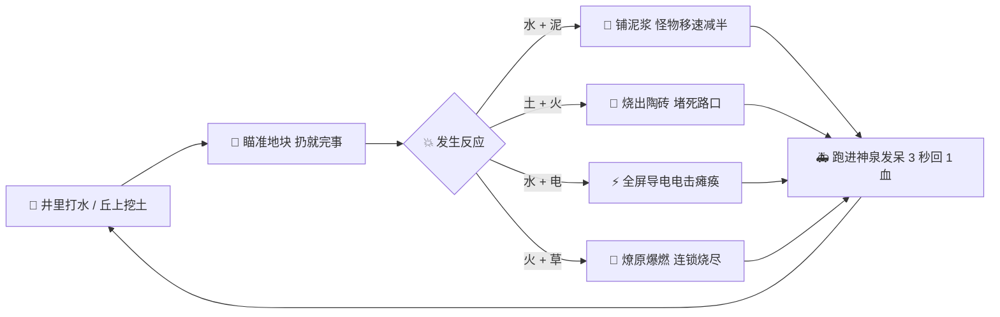
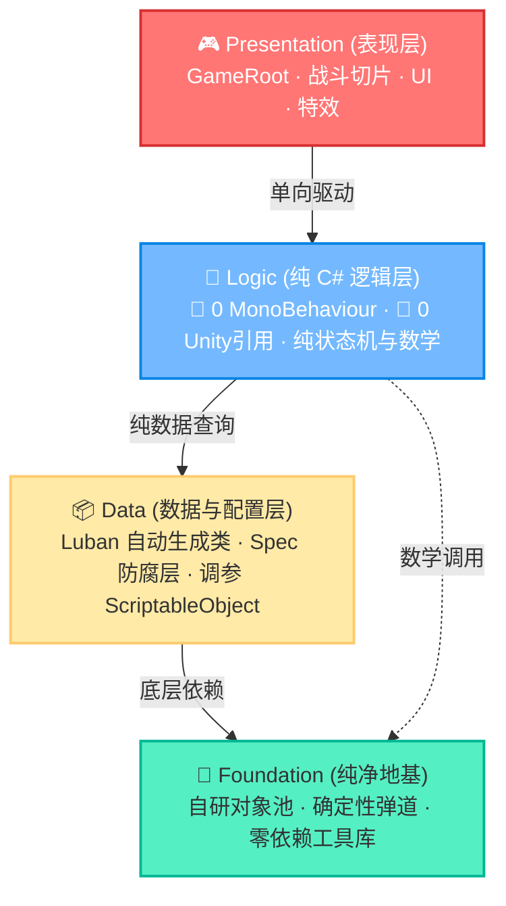
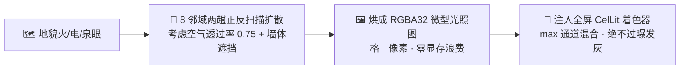
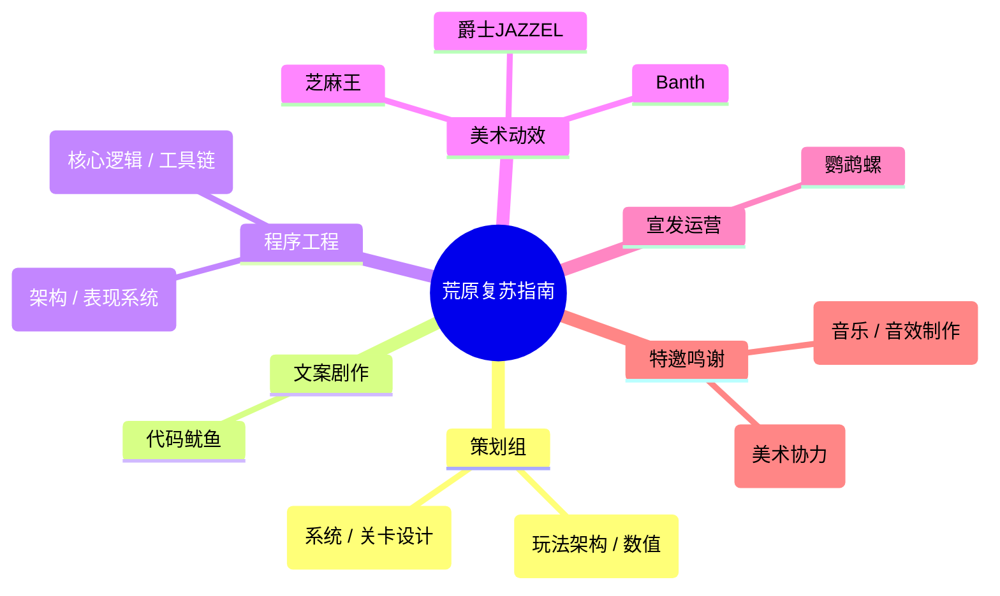

<div align="center">

# 荒原复苏指南 (Wasteland Revival Guide)

**当末日降临，法师在吟唱，而你只有两个水龙头和一把铲子。**

[](https://unity.com/)
[](https://unity.com/srp)
[](#-骨骼清奇的技术地基)
[](#-骨骼清奇的技术地基)
[](#-数据与手感调参)

<br/>

<a href="#-30秒看懂这游戏玩什么">快速上手</a> •
<a href="#-离散化学反应实验室">反应网拆解</a> •
<a href="#-骨骼清奇的技术地基">底层架构</a> •
<a href="#-快速发车指南">运行项目</a> •
<a href="#-制作组名单">演职员表</a>

<br/><br/>

<!-- ====================【留位：主视觉横幅 BANNER】==================== -->
```
<div align="center">
  
  <p><em>▲ <===[[[ 留位：放置游戏主视觉横幅 / Title Banner (建议比例 21:9 或 16:9) ]]]===></em></p>
</div>
```
<!-- =================================================================== -->

</div>

---

## 🎮 30秒看懂这游戏玩什么？

这是一款**俯视角 2D 生存追逐战**。你是一名被派往废弃基地 **REC-006** 的前线勘探员。面对铺天盖地的变异虫群，你**没有任何攻击技能**。

你唯一能做的事：**用手里的纯水和废土，跟战场上本来就有的火池、电桩、冰面、枯藤搞化学反应，借大自然的手灭了它们。**



> [!TIP]
> **【废土重症 ICU · 生命神泉】**  
> 玩家只有 **5 滴血**，数值终身不成长。想回血？全图只有一口泉眼，而且你必须在里面**原地发呆静止整整 3 秒**。  
> 动一下、手抖一下、被摸一下，计时立刻归零。想活命？先进去之前用泥浆减速、陶砖封路，替自己买好这 3 秒钟。

<br/>

<!-- ====================【留位：实机核心循环 GIF】==================== -->
```
<div align="center">
  
  <p><em>▲ <===[[[ 留位：展示 投掷泥浆减速 ➔ 陶砖阻挡 ➔ 跑进神泉原地回血 的爽快 GIF 动图 ]]]===></em></p>
</div>
```
<!-- =================================================================== -->

---

## 🧪 离散化学反应实验室

我们曾经做过一套极其硬核的“温湿度+连续浮点数计算”的反应模型，最后发现不仅把自己人算懵了，玩家也看不懂。  
所以 4.0 版本坚决执行**【所见即所得 · 离散查表 · 首跳当帧】**——水就是水，火就是火，没有玄学数值。

### 1. 元素连锁网扑面而来

```mermaid
flowchart TD
    classDef ball fill:#0984e3,stroke:#74b9ff,color:#fff;
    classDef tile fill:#636e72,stroke:#b2bec3,color:#fff;
    classDef react fill:#d63031,stroke:#ff7675,color:#fff;
    classDef duo fill:#e17055,stroke:#fab1a0,color:#fff;

    W([💧 纯水弹药]):::ball
    E([🪨 纯土弹药]):::ball

    subgraph Ground [战场自然地貌]
        FT[🔥 基础火池]:::tile
        ET[⚡ 基础电源]:::tile
        PT[🌿 基础植物]:::tile
        IT[❄️ 基础冰面]:::tile
    end

    subgraph Direct [一级碰撞反应 (拿球砸)]
        W -->|砸| FT --> R_Steam[💨 蒸汽爆轰: 2伤 + 1.5格击退]:::react
        E -->|砸| FT --> R_Brick[🧱 陶砖矮墙: 实体阻挡 存活15秒]:::react
        W -->|砸| ET --> R_Elec[⚡ 导电区: 泛洪全网导电]:::react
        W -->|砸| PT --> R_Mud[💩 泥浆带: 移速直接腰斩 50%]:::react
    end

    subgraph Duo [二级跨界质变 (发生器相邻触发)]
        FT -.->|相邻| PT ==> D_Fire[🌋 燎原火海: 沿草丛 0.2s/格 延时连环炸]:::duo
        FT -.->|相邻| ET ==> D_Plasma[💥 等离子爆轰: 4伤 + 4格击退 斩杀精英怪]:::duo
        IT -.->|相邻| ET ==> D_BlackHole[🕳️ 超导黑洞: 聚怪向心吸力 5m/s]:::duo
        ET -.->|相邻| PT ==> D_Thorn[🌵 带电荆棘: 踩中硬直麻痹 1.5秒]:::duo
    end
```

### 2. 网格连锁引擎 (`TileChainReactor`)
- **闪电五连鞭**：水和湿土全是电线。只要一片水网通电，**同帧全网麻痹结算**，单次最大支持 128 格扩散，电翻全场。
- **森林大火**：火遇到植物不会瞬间算完，而是以 $0.2\text{s}/\text{格}$ 的波前节奏像多米诺骨牌一样扩散，给足视觉压迫感。

<br/>

<!-- ====================【留位：元素质变与全网导电截图】==================== -->
```
<div align="center">
  
  <p><em>▲ <===[[[ 留位：电弧蔓延整片水池 / 燎原火海点燃草丛的大魄力视觉截图 ]]]===></em></p>
</div>
```
<!-- =================================================================== -->

---

## 🛠️ 骨骼清奇的技术地基

谁说独立小游戏代码就可以乱成一锅粥？本项目贯彻了强迫症级别的工业化整洁度。

### 1. 严格四层物理单向隔离 (`asmdef`)
我们给每个层级都打了独立程序集定义。**想反向引用？编译器直接给你甩脸看。**



- **纯 C# 的逻辑核**：`Logic/` 目录下没有任何 `MonoBehaviour`、不读 `Transform`，甚至连 `Time.time` 都不许直接碰（全靠驱动层精准喂入）。脱离 Unity 引擎它照样能跑单元测试。
- **双帧收敛模型**：杜绝全场景散落各处的流氓 `Update`。全工程唯二驱动入口由常驻单例 `GameRoot` 统一编排调度。
- **热路径绝对 0 GC**：在每帧 Tick、碰撞结算、怪物伤害等高频跑道上，**禁用 LINQ、禁用匿名 Lambda 闭包、禁用瞬时 new**，物理检测全走 `NonAlloc`。

### 2. 告别传统点光：泰拉瑞亚同款网格光照场 (`TileGridLightmap`)
用 Unity URP 2D 原生点光，同屏放超过 16 盏灯显卡就得喘气，而且火海的光斑是圆的，一点都不贴合地砖。
我们自研了一套**微型瓦片网格扩散光场**：



<br/>

<!-- ====================【留位：昼夜光照与网格光对比图】==================== -->
```
<div align="center">
  
  <p><em>▲ <===[[[ 留位：展示黑夜环境下，火光贴着障碍物扩散出硬核阴影的视觉效果图 ]]]===></em></p>
</div>
```
<!-- =================================================================== -->

---

## 📊 数据与手感调参

策划改数值不想老求着程序改代码，程序也不想因为策划想试下击退速度就重新打一遍表。所以我们严厉划界：

```mermaid
flowchart TD
    subgraph Excel [Excel 策划真源 (Luban管线)]
        E1[敌人生命/伤害]
        E2[元素规则 element_rule]
        E3[波次时长与配给]
    end

    subgraph SO [ScriptableObject 程序调参]
        S1[运动学加速度 / 转向衰减]
        S2[投掷抛物线弧度]
        S3[受击闪白时长 / 震屏参数]
    end

    Excel -->|导表生成 C# & JSON| Generated[Generated/ 只读类]
    Generated --> Spec[🛡️ Spec 防腐包装层]
    SO --> Spec
    Spec --> Runtime[🚀 运行时无感读取]
```

- **策划管玩法**：所有的血量、反应配方、波次敌种都在 `ConfigWorkspace/Data/*.xlsx` 里，一键导入。
- **手感管体验**：抛物线、惯性滑行、相机震动全在 `Resources/tuning/*.asset` 里，**游戏运行态（Play Mode）直接拖滑杆即时生效**。

---

## 🚀 快速发车指南

### 1. 环境准备
- **Unity 编辑器版本**：`2022.3.62f3c1` (LTS)
- **渲染管线**：URP 14.0.12 (2D Renderer, Linear 色彩空间)
- **脚本终端**：PowerShell 7+ (`pwsh`)

### 2. 跑起你的第一局
1. 双击打开主玩法基准场景：`Assets/Scenes/Range.unity`。
2. 确保场景第一个根挂有 `[LevelEnvironment_Preset]`，最后一个根是 `Weapon`。
3. 点击 Unity 的 **Play** 按钮直接进入战场！
   - *（想安安静静测试投掷反应？在 Hierarchy 里选中 `CombatRoot`，把 `Enable Waves` 取消勾选，全世界就清静了。）*

### 3. 操作键位速查
|                        键位                         |     动作     | 功能说明                                                |
| :-------------------------------------------------: | :----------: | :------------------------------------------------------ |
| <kbd>W</kbd> <kbd>A</kbd> <kbd>S</kbd> <kbd>D</kbd> |   **走位**   | 8 轴平滑带吸附移动                                      |
|                <kbd>Left Shift</kbd>                |   **冲刺**   | 战术位移，带独立 CD 与输入缓冲（按早了不会吞键）        |
|              <kbd>鼠标左键 (LMB)</kbd>              | **喷射水球** | 消耗 1 格水，制造水体/稀泥/蒸汽                         |
|              <kbd>鼠标右键 (RMB)</kbd>              | **投掷土块** | 消耗 1 格土，制造泥浆/陶砖路障                          |
|                    <kbd>E</kbd>                     | **播撒种子** | 消耗便携种子，在空地上插下专属环境桩                    |
|                    <kbd>Q</kbd>                     | **丢弃种子** | 把拿在手里的种子丢在脚边（带 $1.2\text{s}$ 防误拾冷却） |
|                   <kbd>Esc</kbd>                    | **战术暂停** | 呼出菜单，冻结物理与逻辑时钟                            |

### 4. 严苛的代码守门员
提交代码前，终端敲这三行，保你一生平安：

```powershell
pwsh Tools/compile-gate.ps1 -Topology   # 必须 0 Error, 0 Warning！强力拦截反向引用
pwsh Tools/comment-lint.ps1             # 注释不能水，超出字符预算当场报警
pwsh Tools/luban-mirror.ps1             # 检查配表镜像与生成代码是否对齐
```

---

## 🎬 制作组名单

**深海鱼油工作室 (DeepseaOil Studio)**



<div align="center">

<br/>

*“荒原之上，废墟与新生正同时蔓延。那是复苏的曙光，还是更深邃的黑夜？”*

</div>
